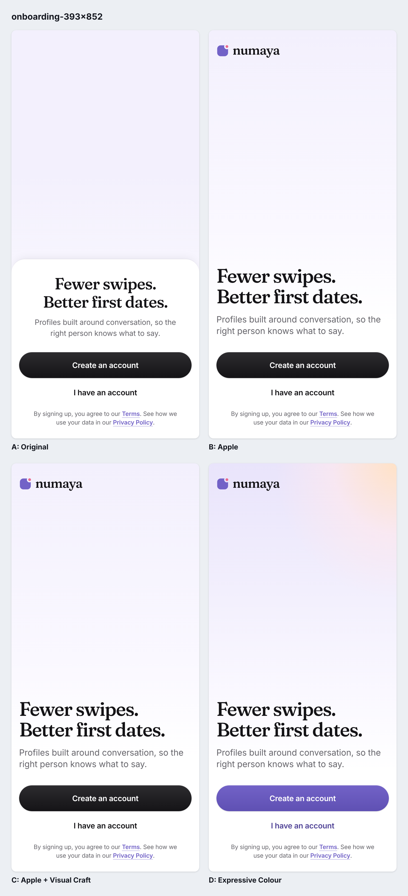
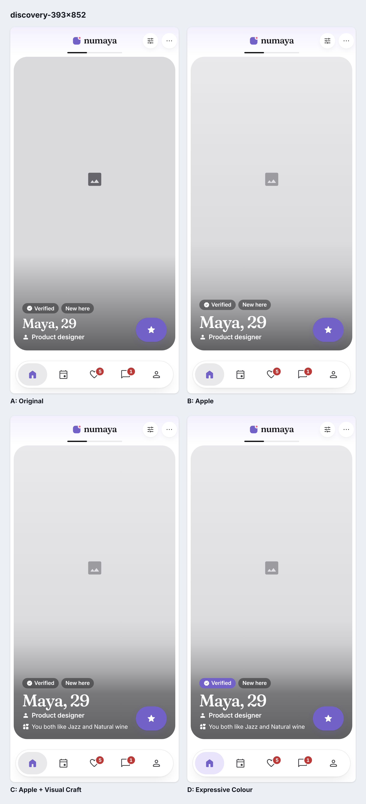
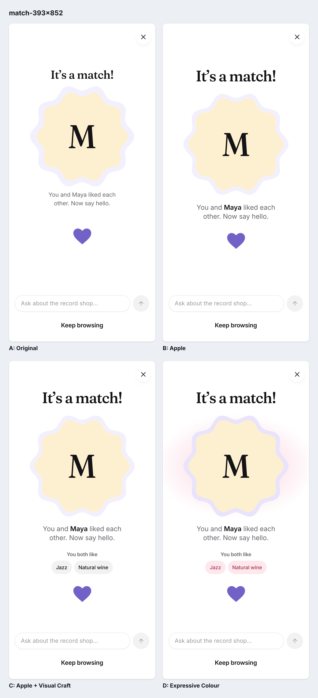
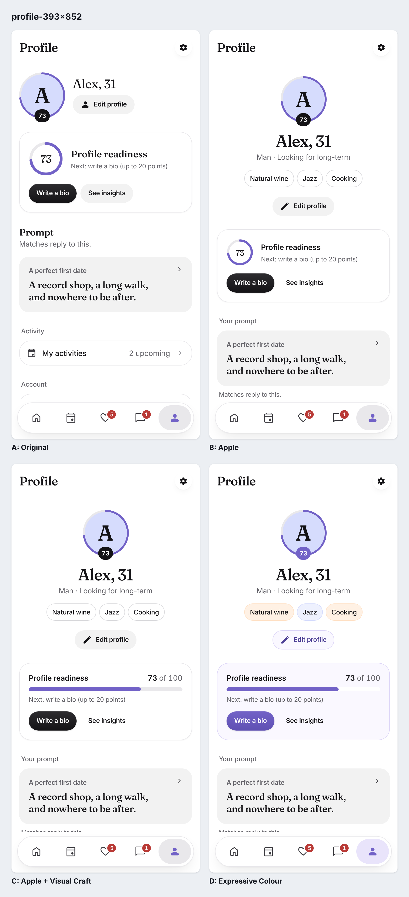
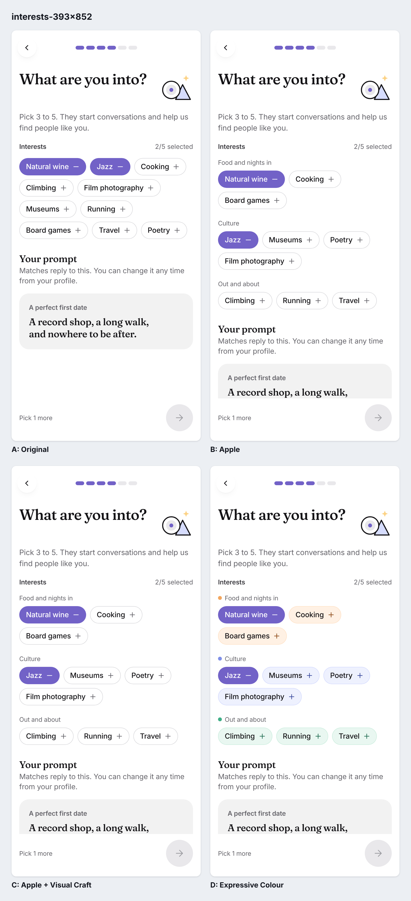

# Variant D — Expressive Colour

Fourth stage of the Numaya design experiment, on the same five screens:
**A: Original** (`7954fa3`) · **B: Apple** (`6e4dbd1`) · **C: Apple + Visual Craft** (`f997e55`) ·
**D: Expressive Colour** (this branch, `experiment/numaya-expressive-color`, based on `f997e55`).

The question: can Numaya be noticeably more colourful, premium and delightful while purple stays
unmistakably the brand and the five screens still read as one product?

**Short answer:** yes, mostly through *where* purple goes (every primary action, selection, the
Verified promise, the readiness score, the current tab) and through three supporting hues with
fixed jobs. D scores highest on every screen (mean 3.9 vs C 3.6), but the gain is almost entirely
in brand recognition, colour harmony and personality; hierarchy, typography and usability are the
same as C. Discover gains least.

## Art direction: purple leads, warmth answers

Variants A–C were mostly ink, white and grey: every primary button and the next-step button were
near-black, so purple appeared as an occasional mark. D moves purple onto the actions and states
people act on, and adds warmth with three supporting hues that each have one job.

| Role | Tokens | Where it appears | Never |
| --- | --- | --- | --- |
| **Brand purple** (identity, action, selection) | `brand` #7262C7, `brand-hover` #5F50B3, `text-brand-deep` #4F4296, lavender tints `brand-tint`, `brand-tint-strong` | Primary buttons and the next-step FAB (`button.primary` now purple), selected chips, Verified pill, readiness score badge and bar, current tab pill, SuperSwipe, match halo | Headlines (stay ink, by product rule) |
| **Coral** (affection) | `accent.coral.surface/text/mark` (rose.100 / new rose.700 / rose.500, the wordmark dot) | What two people share: "You both like" pills on Discover and Match; the warm half of the Welcome and Match light | Controls or states |
| **Apricot** (warmth, "Food and nights in") | `accent.apricot.surface/edge/text/mark` (new) | Food interests; the warm light on Welcome and Match | Text except its `-text` role |
| **Periwinkle** ("Culture") | `accent.periwinkle.*` (new 50/400/800 + existing 100) | Culture interests | — |
| **Mint** ("Out and about") | `accent.mint.*` (new) | Outdoor interests | Success (green stays semantic) |
| **Ink** | new `button.ink` | Pass and Like stay ink, so SuperSwipe is still the one purple choice in the action row | — |
| **Semantic** | unchanged `danger`, `success`, `warning` | Badges and states only | Decoration |

Rules: a category hue is the same wherever that interest appears (Interests and Profile). Selected is
always solid purple and locked chips drop the hue, so state never depends on the category colour.
Every hue's mid tone is a mark only (dots, light); text uses each family's `-text` role, which is
tested at AA on its own surface and edge (`tests/unit/tokens.test.js`). No hue is in the retired
pink band (290–330°).

## Primary comparisons (393 × 852)

**A: Original | B: Apple | C: Apple + Visual Craft | D: Expressive Colour**, shown as 2 × 2 panels
so type stays readable.

### Welcome

Full size: [A](../combined-visual-craft/A_original/onboarding-393x852.png) · [B](../combined-visual-craft/B_apple_design/onboarding-393x852.png) · [C](../combined-visual-craft/C_apple_plus_visual_craft/onboarding-393x852.png) · [D](D_expressive_color/onboarding-393x852.png) · Narrow (375 × 667): [comparison](comparisons/onboarding-375x667.png)

### Discover

Full size: [A](../combined-visual-craft/A_original/discovery-393x852.png) · [B](../combined-visual-craft/B_apple_design/discovery-393x852.png) · [C](../combined-visual-craft/C_apple_plus_visual_craft/discovery-393x852.png) · [D](D_expressive_color/discovery-393x852.png) · Narrow (375 × 667): [comparison](comparisons/discovery-375x667.png)

### Match

Full size: [A](../combined-visual-craft/A_original/match-393x852.png) · [B](../combined-visual-craft/B_apple_design/match-393x852.png) · [C](../combined-visual-craft/C_apple_plus_visual_craft/match-393x852.png) · [D](D_expressive_color/match-393x852.png) · Narrow (375 × 667): [comparison](comparisons/match-375x667.png)

### Profile

Full size: [A](../combined-visual-craft/A_original/profile-393x852.png) · [B](../combined-visual-craft/B_apple_design/profile-393x852.png) · [C](../combined-visual-craft/C_apple_plus_visual_craft/profile-393x852.png) · [D](D_expressive_color/profile-393x852.png) · Narrow (375 × 667): [comparison](comparisons/profile-375x667.png)

### Interests

Full size: [A](../combined-visual-craft/A_original/interests-393x852.png) · [B](../combined-visual-craft/B_apple_design/interests-393x852.png) · [C](../combined-visual-craft/C_apple_plus_visual_craft/interests-393x852.png) · [D](D_expressive_color/interests-393x852.png) · Narrow (375 × 667): [comparison](comparisons/interests-375x667.png)

More states: [Discover scrolled](comparisons/discovery-details-393x852.png) ·
[Profile scrolled](comparisons/profile-details-393x852.png) ·
[Interests at the five-pick limit](comparisons/interests-max-393x852.png) ·
[Welcome desktop 1440 × 900](comparisons/onboarding-1440x900.png). Narrow-mobile versions of each:
[Discover scrolled](comparisons/discovery-details-375x667.png),
[Profile scrolled](comparisons/profile-details-375x667.png),
[Interests at limit](comparisons/interests-max-375x667.png).

All Variant D captures: [`D_expressive_color/`](D_expressive_color/). A, B and C are the verified
captures from [`../combined-visual-craft/`](../combined-visual-craft/) (same script settings,
fixtures and fonts; reused in place, not copied). Other screens touched by the shared changes:
[`regression/`](regression/). Gallery for local viewing: `index.html`.

Desktop: only Welcome has a designed desktop layout; the flow screens stretch in single-screen
mode and are not compared at 1440.

## Screen by screen

### Welcome — keep
1. **Original:** two-thirds empty lavender, no brand, copy on a sheet over nothing.
2. **Apple:** wordmark, editorial left-aligned headline, sheet removed.
3. **Visual Craft:** tested left-aligning the legal text; rejected (no gain). C = B.
4. **Expressive colour:** "Create an account" is solid purple (was ink), "I have an account" is deep
   purple, and the wash is lit from the top right with apricot and a breath of coral, echoing the
   wordmark's coral dot. The headline stays ink.
5. **Brand:** much more recognisable; purple now carries the action, not only the logo.
6. **Supporting colour:** adds warmth to the empty hero without inventing artwork.
7. **Too much?** No. One light source, no shapes. The empty hero is still the main weakness (asset missing).

### Discover — keep (smallest gain)
1. **Original:** inverted prompt hierarchy, muddy scrim.
2. **Apple:** answer in Fraunces, label-style section titles, 40px name.
3. **Visual Craft:** "You both like" cue on the card; scrim fixed to AA.
4. **Expressive colour:** Verified is a solid purple pill (a brand promise, not grey glass); the
   "You both like" pills further down are coral; the current tab sits on a lavender pill.
5. **Brand:** modestly stronger (Verified, tab).
6. **Supporting colour:** coral marks shared interests consistently with Match.
7. **Too much?** No; the photo area is untouched. Real-photo quality is still unevaluated: the repo
   has no photographs, only the honest grey placeholder.

### Match — keep
1. **Original:** small title, a heart floating in a void, three uncoordinated pastels.
2. **Apple:** display title, calmer halo, name in ink.
3. **Visual Craft:** real shared interests between the copy and the illustration slot.
4. **Expressive colour:** a stronger lavender halo; a warm apricot-to-coral light behind the person
   (scoped to the portrait so it never reaches the text); the shared pills are coral.
5. **Brand:** purple frames the person and the heart; clearly Numaya.
6. **Supporting colour:** the yellow monogram fallback now sits inside a warm light rather than
   fighting the lavender: the palette finally reads as one set. White page kept.
7. **Too much?** Close to the limit; no further colour should be added here. The hands artwork is
   still missing (slot preserved).

### Profile — keep
1. **Original:** score shown twice, a settings page with an avatar.
2. **Apple:** centred identity, facts and interests, one heading style.
3. **Visual Craft:** readiness card meter drawn as a bar so only the avatar shows a ring.
4. **Expressive colour:** purple score badge on the ring; the person's interests in their category
   hues; Edit profile as the lavender brand button; the readiness card is the one lavender surface,
   with a purple "Write a bio".
5. **Brand:** strongest gain of the five; purple runs from ring to badge to card to action.
6. **Supporting colour:** interests now say something about the person at a glance.
7. **Too much?** No; the sections below stay white. Only the readiness card is tinted.

### Interests — keep, watch one detail
1. **Original:** solid purple slabs, a broken-looking locked state, one wall of chips.
2. **Apple:** labelled sets, locked chips keep an outline.
3. **Visual Craft:** no change (no defensible gain).
4. **Expressive colour:** each set has one hue (apricot / periwinkle / mint): a dot on its label
   and a pale tint, tinted hairline and deep glyph on its chips. Selected stays solid purple; locked
   chips drop the hue. The next button is purple.
5. **Brand:** selection now pops harder against coloured, not grey, neighbours.
6. **Supporting colour:** makes the three sets scannable (hierarchy 3 → 4).
7. **Too much?** This is the busiest screen (restraint stays 3). Periwinkle Culture chips are close to
   lavender; they differ from selected purple strongly, but watch this if lavender surfaces are
   added nearby.

## Scores (reviewer judgements, 1–5)

H hierarchy · C composition · T typography · Cr craft · D distinctiveness · R restraint · U usability.
Brand = brand recognition; Harmony = colour harmony and intentionality (both new in this stage and
scored for all four variants). A–C keep their earlier scores on the first seven criteria, so their
means differ from earlier reports only because the two new criteria were added.

| Screen | Variant | H | C | T | Cr | D | R | U | Brand | Harmony | Mean |
| --- | --- | --- | --- | --- | --- | --- | --- | --- | --- | --- | --- |
| Welcome | A | 3 | 2 | 3 | 3 | 2 | 4 | 4 | 2 | 3 | 2.9 |
|  | B | 4 | 3 | 4 | 4 | 3 | 4 | 4 | 3 | 3 | 3.6 |
|  | C | 4 | 3 | 4 | 4 | 3 | 4 | 4 | 3 | 3 | 3.6 |
|  | D | 4 | 3 | 4 | 4 | 4 | 4 | 4 | 5 | 4 | 4.0 |
| Discover | A | 3 | 3 | 3 | 3 | 2 | 4 | 4 | 3 | 3 | 3.1 |
|  | B | 4 | 3 | 4 | 4 | 3 | 4 | 3 | 3 | 3 | 3.4 |
|  | C | 4 | 3 | 4 | 4 | 4 | 4 | 4 | 3 | 3 | 3.7 |
|  | D | 4 | 3 | 4 | 4 | 4 | 4 | 4 | 4 | 4 | 3.9 |
| Match | A | 3 | 2 | 3 | 3 | 3 | 3 | 4 | 3 | 2 | 2.9 |
|  | B | 4 | 3 | 4 | 3 | 3 | 3 | 4 | 3 | 2 | 3.2 |
|  | C | 4 | 4 | 4 | 3 | 4 | 3 | 4 | 3 | 3 | 3.6 |
|  | D | 4 | 4 | 4 | 4 | 4 | 3 | 4 | 4 | 4 | 3.9 |
| Profile | A | 2 | 2 | 3 | 3 | 2 | 3 | 3 | 3 | 3 | 2.7 |
|  | B | 4 | 4 | 4 | 4 | 3 | 3 | 4 | 3 | 3 | 3.6 |
|  | C | 4 | 4 | 4 | 4 | 3 | 4 | 4 | 3 | 3 | 3.7 |
|  | D | 4 | 4 | 4 | 4 | 4 | 4 | 4 | 5 | 4 | 4.1 |
| Interests | A | 3 | 3 | 3 | 2 | 2 | 3 | 3 | 3 | 3 | 2.8 |
|  | B | 3 | 4 | 3 | 4 | 3 | 3 | 4 | 3 | 3 | 3.3 |
|  | C | 3 | 4 | 3 | 4 | 3 | 3 | 4 | 3 | 3 | 3.3 |
|  | D | 4 | 4 | 3 | 4 | 4 | 3 | 4 | 4 | 4 | 3.8 |

Mean across the five screens: **A 2.9 · B 3.4 · C 3.6 · D 3.9**.

Where D beats C: brand recognition (+1 to +2 on every screen), colour harmony (+1 everywhere),
distinctiveness (+1 on Welcome, Profile, Interests), craft on Match (+1, the light and halo work
with the fallback colours instead of against them) and hierarchy on Interests (+1). No criterion
regressed on any screen.

**Benefited most:** Profile and Welcome. **Least:** Discover (the card is a grey placeholder; colour
can only reach its badges and the scroll below).

## Verification

Contrast measured on the rendered pages (`node scripts/expressive-color-contrast.mjs`; computed
colours, gradients at their lightest stop):

| Screen | Element | Foreground | Background | Ratio |
| --- | --- | --- | --- | --- |
| Welcome | Create an account (white on purple, lightest stop) | #ffffff | #7262c7 | 4.90:1 |
| Welcome | I have an account (deep purple on white) | #4f4296 | #ffffff | 8.23:1 |
| Welcome | Legal link | #7262c7 | #ffffff | 4.90:1 |
| Discover | Verified pill | #ffffff | #7262c7 | 4.90:1 |
| Discover | SuperSwipe glyph | #ffffff | #7262c7 | 4.90:1 |
| Discover | Active tab label | #4f4296 | #e9e4fb | 6.64:1 |
| Discover | You both like pill (coral) | #a8324f | #fde8ee | 5.55:1 |
| Match | Shared pill (coral) | #a8324f | #fde8ee | 5.55:1 |
| Match | You both like label | #66656b | #ffffff | 5.77:1 |
| Match | Copy | #66656b | #ffffff | 5.77:1 |
| Profile | Score badge | #ffffff | #7262c7 | 4.90:1 |
| Profile | Apricot interest chip | #141316 | #fff1e4 | 16.71:1 |
| Profile | Periwinkle interest chip | #141316 | #eef1fe | 16.44:1 |
| Profile | Edit profile (brand button) | #4f4296 | #faf8ff | 7.81:1 |
| Profile | Readiness caption on lavender | #66656b | #faf8ff | 5.48:1 |
| Profile | Write a bio (white on purple, lightest stop) | #ffffff | #7262c7 | 4.90:1 |
| Interests | Selected chip | #ffffff | #7262c7 | 4.90:1 |
| Interests | Apricot chip | #141316 | #fff1e4 | 16.71:1 |
| Interests | Apricot + glyph (non-text, 3:1) | #8a4512 | #fff1e4 | 6.45:1 |
| Interests | Periwinkle chip | #141316 | #eef1fe | 16.44:1 |
| Interests | Periwinkle + glyph (non-text) | #34449a | #eef1fe | 7.64:1 |
| Interests | Mint chip | #141316 | #e9f7f1 | 16.78:1 |
| Interests | Mint + glyph (non-text) | #1d6a4f | #e9f7f1 | 5.90:1 |
| Interests | Set label | #66656b | #ffffff | 5.77:1 |
| Interests at max | Locked chip (disabled; exempt) | #9b9ba0 | #ffffff | 2.77:1 |
| Interests at max | Next button glyph (white on purple) | #ffffff | #7262c7 | 4.90:1 |

Text over the Discover card scrim (pixel-sampled beside each line, `scripts/combined-card-contrast.mjs`):
name 4.21 / 3.73:1 (large text, ≥ 3:1), job 5.01 / 4.80:1, cue 5.55 / 5.29:1 at 393 / 375.

Not colour-only: selected chips carry a − glyph and `aria-pressed`, locked chips `aria-disabled`;
category hue never encodes state; the score has its number; Verified has its label and icon.
Unselected chip edges (tinted hairlines) are below 3:1 against white, as the neutral hairlines were
in A–C; the chips are identified by their text labels.

Commands run:

- `npm run check` (tokens check, icons check, 118 unit tests, production build): pass.
- `npm run test:e2e`: 144/144 smoke, 88/88 product: pass.
- `npm run test:a11y`: no serious or critical violations.
- Captures: Fraunces and Inter loaded; no console errors, no horizontal overflow at any viewport
  (D five screens and ten regression screens).

Tests changed, deliberately, because they encoded the previous palette:

- `tests/unit/tokens.test.js` now accepts the four accent families and adds an AA test for every
  family's text role.
- `tests/unit/css-usage.test.js` registers the `--chip-tone-*` variables.
- `tests/e2e/smoke.mjs`: shared pills are expected coral, the active tab pill lavender.

`npm run gallery` was not run because it rewrites `artifacts/ui-gallery/`; the regression captures
above stand in for it.

Outstanding: no real profile photography (photo treatment unevaluated); the welcome hero and the
match hands artwork are still unsupplied (slots kept, nothing fabricated); no human reviewer
compared the variants yet.

## Files changed (D vs C)

- `tokens/numaya.tokens.json` → regenerated `src/design-system/tokens.{css,js}`: apricot, mint,
  periwinkle 50/400/800, rose 700 primitives; `accent.coral/apricot/periwinkle/mint` roles;
  `button.primary` → purple; new `button.ink`.
- `src/design-system/styles/content.css`: action bar on ink tokens, Verified pill, coral shared
  pills, match halo and light.
- `src/design-system/styles/components.css`: lavender current-tab pill.
- `src/design-system/styles/selection.css`: chip tone classes and set marks.
- `src/design-system/components/Selection.jsx` (`Chip tone`, `ChipGroup` set `tone`),
  `Content.jsx` (Verified pill class).
- `src/flows/data.js` (`tone` per interest set, `INTEREST_TONE`), `src/flows/screens.jsx`
  (profile chips, brand Edit button), `src/flows/flows.css` (score badge, readiness card).
- `src/prototype/styles/screens.css`: Welcome light and secondary action.
- Scripts: `scripts/expressive-color.mjs`, `scripts/expressive-color-contrast.mjs`.
