# Skill-combination matrix

Which design-skill approach makes Numaya look best? Eight versions of the same five screens, rendered
under identical conditions and judged side by side.

**Recommendation in one line:** use **Apple Design + Impeccable (variant C)** as the method for
application-wide refinement. It scored highest, its changes are the ones you can see, and it costs a
moderate patch. UI/UX Pro Max and Liquid Glass did not add enough on top of it to justify their cost on
these screens today. The full stack (H) did not beat C.

- [The matrix](#the-matrix) · [Overview](#overview) · [Per-screen comparisons](#per-screen-comparisons)
- [Scores](#scores) · [What each skill did](#what-each-skill-did) · [The eight questions](#the-eight-questions)
- [Verification](#verification) · [Limitations and missing assets](#limitations-and-missing-assets)
- [Recommendation](#recommendation) · [Patches](#patches) · [Reproduce](#reproduce)

## The matrix

| ID | Version | Skills applied, in order | Started from | Patch |
|---|---|---|---|---|
| A | Original | none | `7954fa3` | (baseline) |
| B | Apple | Apple Design | `6e4dbd1` | (baseline) |
| C | Apple + Impeccable | Apple → Impeccable | `6e4dbd1` | [C-impeccable.patch](../../patches/C-impeccable.patch) |
| D | Apple + UI/UX Pro Max | Apple → UI/UX Pro Max | `6e4dbd1` | [D-uiux-pro-max.patch](../../patches/D-uiux-pro-max.patch) |
| E | Apple + Liquid Glass | Apple → Liquid Glass (selective) | `6e4dbd1` | [E-liquid-glass.patch](../../patches/E-liquid-glass.patch) |
| F | Apple + Impeccable + UI/UX Pro Max | Apple → Impeccable → UI/UX Pro Max | `6e4dbd1` | [F-impeccable-uiux.patch](../../patches/F-impeccable-uiux.patch) |
| G | Apple + UI/UX Pro Max + Liquid Glass | Apple → UI/UX Pro Max → Liquid Glass | `6e4dbd1` | [G-uiux-glass.patch](../../patches/G-uiux-glass.patch) |
| H | Full stack | Apple → Impeccable (checkpoint 1) → UI/UX Pro Max (checkpoint 2) → Liquid Glass | `6e4dbd1` | [H-full-stack.patch](../../patches/H-full-stack.patch) |

Every variant was built in its own Git worktree from `6e4dbd1`. C, D and E are independent. F, G and H
apply their skills in the order shown. Nothing was carried between variants except where the order says
so. This branch keeps the Apple-only product code (B). The variants exist only as patches and
screenshots.

**Screens and routes** (verified against the app; same seeded state for every variant):
Welcome `index.html` · Discover `flows.html?screen=discovery` · Match `flows.html?screen=match` ·
Profile `flows.html?screen=profile` · Interests `flows.html?screen=interests`.

**Capture conditions:** Chromium (Playwright), device pixel ratio 2, reduced motion, Fraunces and Inter
confirmed loaded before each shot, seeded `Math.random`, and identical `localStorage` sessions. Viewports
are 393 × 852 and 375 × 667 for every screen. Welcome is also captured at 1440 × 900, because it is the
only screen with a real desktop layout.

**A and B are genuine.** All 22 A and B captures are pixel-identical to the earlier Apple experiment's
`before` and `after` screenshots in [`artifacts/apple-design-experiment/`](../apple-design-experiment/).

## Overview

All five screens × eight variants at 393 × 852. Use it for scanning; the sheets below are large enough to
judge type and spacing.

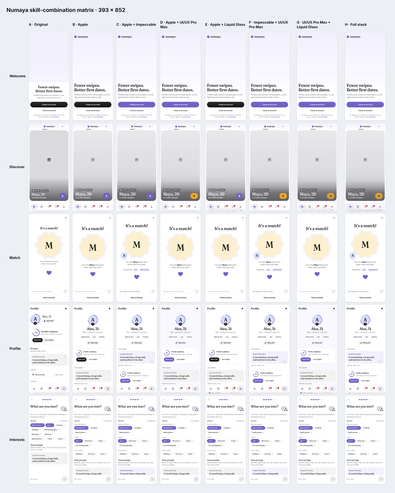

### Where the variants are actually identical

A pixel hash of every screenshot shows where a skill changed nothing. That is useful evidence in itself.

| Screen | Identical groups (393 × 852) | Reading |
|---|---|---|
| Welcome | A · **B E** · **C D F G H** | Glass found no surface. Every non-glass skill made the same change: the primary button turned purple. |
| Discover | all eight differ | Every skill touched this screen. |
| Match | A · **B D E G** · **C F H** | Only Impeccable changed Match. UI/UX Pro Max and Glass left it as Apple had it. |
| Profile | all eight differ (C = F at 375 × 667) | |
| Interests | A · **B D E G** · **C F H** (all of B–H identical at 375 × 667) | Only Impeccable's prompt object reaches this screen, and only below the fold on narrow phones. |

## Per-screen comparisons

Each sheet is shown at 393 × 852, followed by a link to the narrow-mobile 375 × 667 sheet. Every
full-size screenshot is linked in [All screenshots](#all-screenshots).

### Welcome

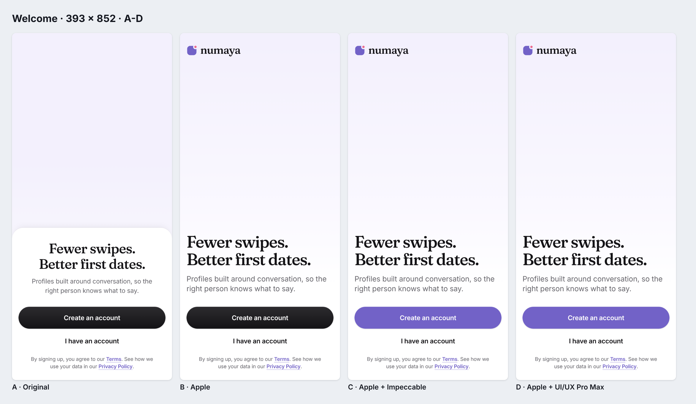
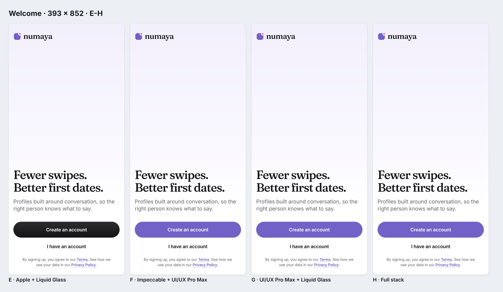

Narrow: [A–D 375](sheets/welcome-A-D-375x667.png) · [E–H 375](sheets/welcome-E-H-375x667.png) ·
Desktop: [all eight at 1440 × 900](sheets/welcome-desktop-1440x900.png)

**Strongest: C, D, F, G and H (tied, pixel-identical).** The Apple composition is unchanged. The one
improvement is that purple now owns the primary action ("Create an account"). That was Impeccable's
first P1 finding, and UI/UX Pro Max independently suggested a branded CTA. Welcome is held back in every
variant by the missing hero illustration: the upper half is an empty gradient.

### Discover

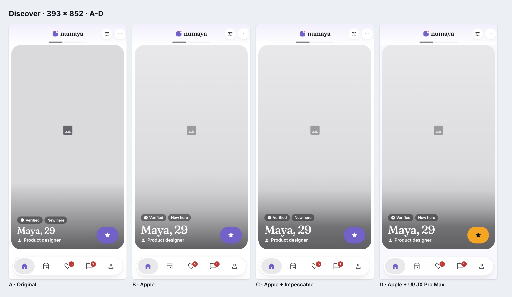
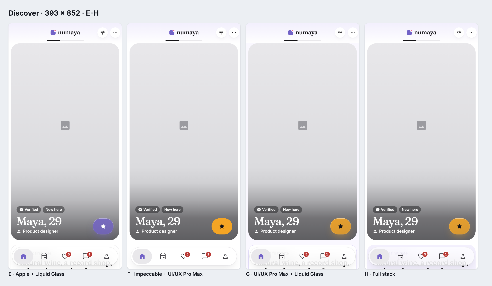

Narrow: [A–D 375](sheets/discover-A-D-375x667.png) · [E–H 375](sheets/discover-E-H-375x667.png) ·
Glass evidence, scrolled: [B](screens/discover-scrolled-B-apple-393x852.png) ·
[E](screens/discover-scrolled-E-glass-393x852.png) · [G](screens/discover-scrolled-G-uipro-glass-393x852.png) ·
[H](screens/discover-scrolled-H-full-stack-393x852.png)

**Strongest: C.** C has the stronger scrim (white name 4.66:1 or better, up from 3.06:1). Its prompt
becomes a lavender pull-quote object with a quiet Fraunces quotation mark, which is the first thing that
says "conversation-first". SuperSwipe stays purple, so the card keeps one accent. D, F, G and H swap
SuperSwipe for a gold "reward" accent. The ink star is easier to read (9.07:1), but a second saturated
colour now competes with purple on the most-seen screen. It also reads closer to another dating brand's
yellow than to Numaya. E, G and H float the tab bar as glass. With no photography, what shows through is
grey placeholder and ghosted prompt text, which is visibly busier than B (see the narrow sheet).

### Match

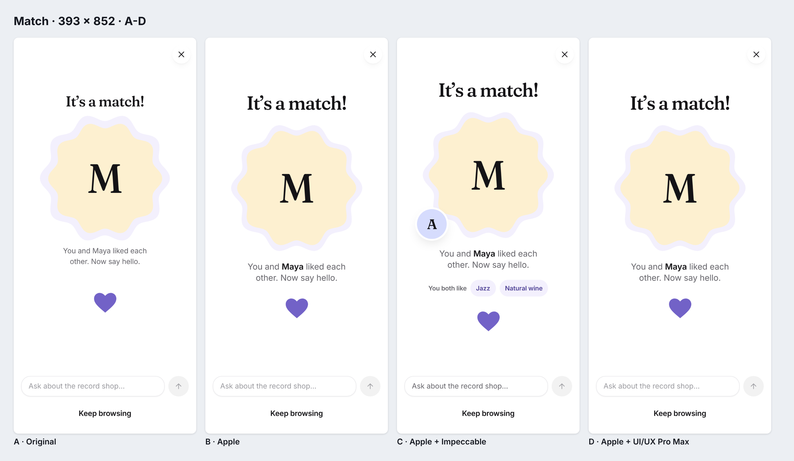
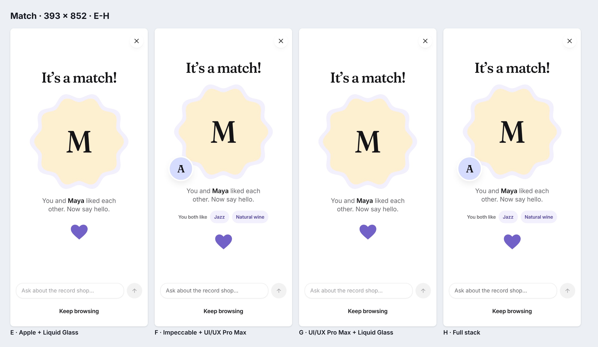

Narrow: [A–D 375](sheets/match-A-D-375x667.png) · [E–H 375](sheets/match-E-H-375x667.png)

**Strongest: C (= F = H).** This is the biggest single improvement in the experiment. The match moment
now shows the pair (your monogram overlapping theirs) and the shared ground ("You both like · Jazz ·
Natural wine", from real data). That gives the opener composer something to point at. It came from
Impeccable's critique ("Match moment shows one monogram, not the pair or shared ground"). UI/UX Pro Max
and Liquid Glass changed nothing here (B = D = E = G).

### Profile

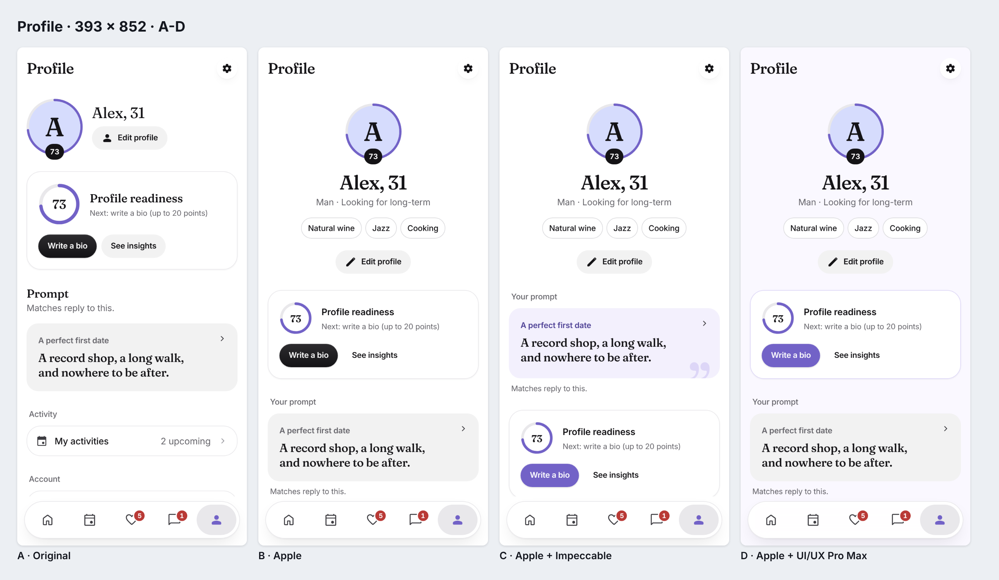
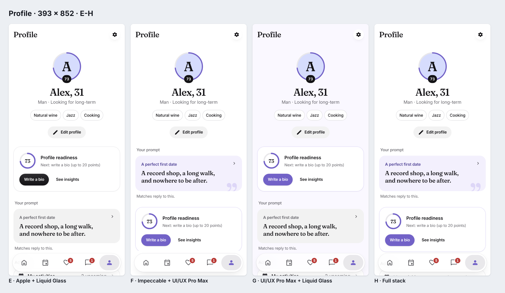

Narrow: [A–D 375](sheets/profile-A-D-375x667.png) · [E–H 375](sheets/profile-E-H-375x667.png)

**Strongest: C and F (tied, pixel-identical at 375).** The prompt moves above the readiness score and
becomes the same lavender object as on Discover, so the profile leads with what matches reply to, not
with a metric. The primary button is purple. D's lavender page wash is pleasant but makes the white cards
look pasted on. H adds the glass tab bar, through which the next section's heading ghosts at rest.

### Interests

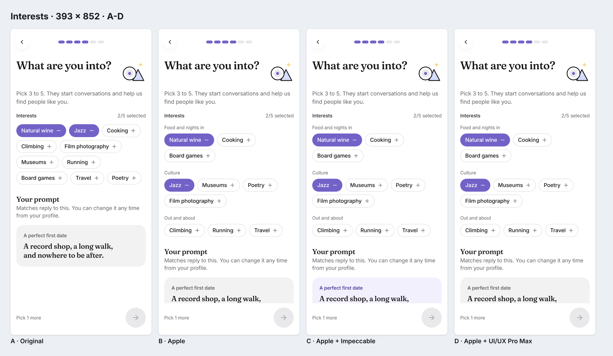
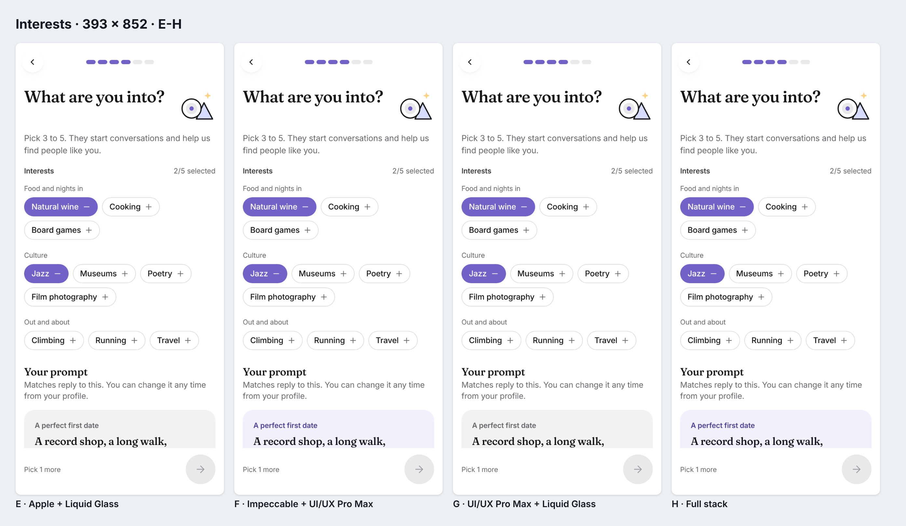

Narrow: [A–D 375](sheets/interests-A-D-375x667.png) · [E–H 375](sheets/interests-E-H-375x667.png)

**Strongest: C (= F = H) by a small margin.** The only change in any variant is the lavender prompt card
at the foot of the screen, which ties onboarding to the same object seen on Discover and Profile. At
375 × 667 it is below the fold, and B to H are identical there. **Interests is effectively best with
Apple Design alone.**

## Scores

The ten criteria use a 1–5 scale: **Hi** visual hierarchy · **Co** composition and use of space ·
**Ty** typography and proportions · **Cr** component craftsmanship · **Di** distinctiveness and
personality · **Col** colour harmony · **Su** surface and material · **Re** restraint · **Us** usability ·
**Br** brand recognition and consistency.

These are structured design judgments made from the screenshots, not measurements. Pixel-identical
screens get identical scores.

| Screen | Var | Hi | Co | Ty | Cr | Di | Col | Su | Re | Us | Br | Mean |
|---|---|---|---|---|---|---|---|---|---|---|---|---|
| Welcome | A | 3 | 2 | 3 | 3 | 2 | 3 | 3 | 4 | 4 | 3 | 3.0 |
| | B, E | 4 | 3 | 4 | 4 | 2 | 3 | 3 | 4 | 4 | 3 | 3.4 |
| | C, D, F, G, H | 4 | 3 | 4 | 4 | 3 | 4 | 3 | 4 | 4 | 4 | **3.7** |
| Discover | A | 3 | 3 | 3 | 3 | 2 | 3 | 3 | 4 | 4 | 3 | 3.1 |
| | B | 4 | 3 | 4 | 4 | 3 | 3 | 3 | 4 | 4 | 3 | 3.5 |
| | C | 4 | 4 | 4 | 4 | 4 | 4 | 3 | 4 | 4 | 4 | **3.9** |
| | D | 4 | 3 | 4 | 4 | 4 | 3 | 3 | 3 | 4 | 3 | 3.5 |
| | E | 4 | 3 | 4 | 4 | 3 | 3 | 4 | 3 | 3 | 3 | 3.4 |
| | F | 4 | 4 | 4 | 4 | 4 | 3 | 3 | 3 | 4 | 3 | 3.6 |
| | G | 4 | 3 | 4 | 4 | 4 | 3 | 4 | 3 | 3 | 3 | 3.5 |
| | H | 4 | 4 | 4 | 4 | 4 | 3 | 4 | 3 | 3 | 3 | 3.6 |
| Match | A | 3 | 2 | 3 | 3 | 3 | 3 | 3 | 4 | 4 | 3 | 3.1 |
| | B, D, E, G | 4 | 3 | 4 | 4 | 3 | 3 | 3 | 4 | 4 | 3 | 3.5 |
| | C, F, H | 4 | 4 | 4 | 4 | 4 | 4 | 3 | 4 | 4 | 4 | **3.9** |
| Profile | A | 3 | 2 | 3 | 3 | 2 | 3 | 3 | 3 | 3 | 3 | 2.8 |
| | B | 4 | 4 | 4 | 4 | 3 | 3 | 3 | 4 | 4 | 3 | 3.6 |
| | C | 4 | 4 | 4 | 4 | 4 | 4 | 3 | 4 | 4 | 4 | **3.9** |
| | D | 4 | 4 | 4 | 4 | 3 | 4 | 3 | 4 | 4 | 4 | 3.8 |
| | E | 4 | 4 | 4 | 4 | 3 | 3 | 4 | 3 | 3 | 3 | 3.5 |
| | F | 4 | 4 | 4 | 4 | 4 | 4 | 3 | 4 | 4 | 4 | **3.9** |
| | G | 4 | 4 | 4 | 4 | 3 | 4 | 4 | 3 | 3 | 4 | 3.7 |
| | H | 4 | 4 | 4 | 4 | 4 | 4 | 4 | 3 | 3 | 4 | 3.8 |
| Interests | A | 3 | 3 | 3 | 3 | 2 | 3 | 3 | 3 | 4 | 3 | 3.0 |
| | B, D, E, G | 4 | 4 | 4 | 4 | 3 | 3 | 3 | 4 | 4 | 3 | 3.6 |
| | C, F, H | 4 | 4 | 4 | 4 | 3 | 4 | 3 | 4 | 4 | 4 | **3.8** |

### Overall (mean of the five screen means)

| Rank | Variant | Mean | Patch size (vs `6e4dbd1`) |
|---|---|---|---|
| 1 | **C · Apple + Impeccable** | **3.84** | 9 files, +188 / −43 |
| 2 | F · Impeccable + UI/UX Pro Max | 3.78 | 10 files, +223 / −46 |
| 3 | H · Full stack | 3.76 | 11 files, +325 / −55 |
| 4 | D · Apple + UI/UX Pro Max | 3.62 | 6 files, +86 / −25 |
| 5 | G · UI/UX Pro Max + Liquid Glass | 3.60 | 7 files, +188 / −34 |
| 6 | B · Apple | 3.52 | (baseline) |
| 7 | E · Apple + Liquid Glass | 3.48 | 6 files, +102 / −9 |
| 8 | A · Original | 3.00 | (baseline) |

The patch line counts include the regenerated `tokens.css` and `tokens.js`.

**Strongest variant: C.** **Weakest new variant: E**, which scored slightly below Apple alone. The spread
among C, F and H is small (0.08). What separates them is not quality but the fact that F and H add cost
and a second accent colour without adding a visible improvement.

## What each skill did

### Impeccable (C; first layer of F and H)

**Method.** I ran `/impeccable init` (product context in `PRODUCT.md`: intentional daters,
conversation-first, brand system, no fabricated imagery), then `/impeccable critique` on the Apple
baseline. The critique scored 26/40, with three P1 findings; it is saved verbatim in
[skill-output/impeccable-critique-apple-baseline.md](skill-output/impeccable-critique-apple-baseline.md).
I acted on these findings:

- **colorize:** purple owns the primary action.
- **delight:** the match shows the pair and what you share.
- **bolder:** one prompt object, used everywhere.
- **polish:** the scrim reaches 4.5:1, h1 is followed by h2, and the composer placeholder contrast is
  fixed.
- **layout:** the prompt sits above the score on Profile.

**Improved.** Brand ownership of actions; a product signature (the lavender prompt with its quote mark);
the Match moment; heading order; contrast.

**Did not improve.** Welcome's empty upper half; Interests.

**Inconsistency or complexity introduced.** Little. It adds one component prop pair (`you`, `shared` on
`MatchCelebration`) and a handful of token-only rules.

**Usability and contrast.** Both improved: the name over the photo went from 3.06:1 to 4.66:1 or better.

**Rejected.** "SuperSwipe is the only card action": the spec places Like and Pass at the end of the
profile, so changing it would build behaviour the spec does not describe. "Icon-only tabs": a product
decision outside this experiment.

### UI/UX Pro Max (D; second layer of F, first layer of G)

**Method.** Offline searches with the skill's own CLI (Python 3.13 was present):
`--design-system "dating app conversation-first premium mobile"`, plus colour, typography, UX and style
domain searches. The output is saved verbatim in
[skill-output/uiux-pro-max-searches.md](skill-output/uiux-pro-max-searches.md).

**Used.**
- A warm reward accent for the premium action (gold `#f5a524` with an ink star, 9.07:1).
- A branded primary CTA.
- A faint brand tint on tabbed pages, with lavender card hairlines.

**Rejected.**
- The recommended rose/orange palette (`#E11D48` / `#EA580C`). It conflicts with the pinned brand purple.
- Playfair Display and Source Serif. They conflict with the pinned Fraunces/Inter pair.
- The "Vibrant & Block-based" style.
- The "Hero + Testimonials" landing pattern. A testimonial carousel would be fabricated social proof.
- Swipe-hint and action-placement changes. They conflict with the spec.

**Inconsistency introduced.** The tabbed pages are tinted, but chat, match and settings are not
(the e2e contract caught this). The gold accent sits outside the pinned palette (the unit test caught
this).

**Verdict.** It mainly produced *more recommendations*, most of them generic catalogue output for "dating
app". The few that applied were small. The gold accent is the only visible signature, and it splits the
colour story.

### Liquid Glass (E; last layer of G and H)

**Method.** I followed the skill's four rules.

- The only functional surface with a real, moving backdrop is the **tab bar**. It became the *menu* tier:
  a 72% surface wash, `blur(22px) saturate(140%)`, the rim restated as tokens, and a
  `prefers-reduced-transparency` fallback. To have something behind it, it now floats over the content
  instead of sitting below it.
- The **SuperSwipe on the photo** got the *coloured-glass FAB* recipe: purple in E, gold in G and H.
- **Not glassed:**
  - Welcome, Match and Interests, which have no backdrop.
  - The pills on the photo. The colourless chip tier would fail contrast there.
- **Not ported:** the Angular refraction directive. It would need to be rewritten for React, and SVG
  `backdrop-filter` renders in Chromium only. So E is the plain `backdrop-filter` fallback the skill
  prescribes for non-Chromium browsers.

**Glass legibility (measured, see [Verification](#verification)).** Tab icons stay at 7.7:1 or better
over the busiest content measured, so contrast passes. The problem is visual: large Fraunces prompt text
ghosts through the bar behind the icons. With a 55% wash (the skill's default) the text was legible
through the glass, so I raised it to 72%, and it still reads through. With no photography, there is
nothing beautiful behind the glass. The skill's own first rule ("glass needs a backdrop") is therefore
not satisfiable on these screens yet.

**Complexity.** The floating bar needs absolute positioning and recomputed bottom padding on every
tabbed screen. The first Discover attempt let the card run under the bar, which I fixed. A floating bar also
**contradicts the current navigation spec** ("bar sits below the scrolling content, never over it"),
which E, G and H fail in e2e. Adopting glass is a navigation decision, not just a styling one.

### H checkpoints

| Checkpoint | Contents | Result |
|---|---|---|
| 1 | Apple → Impeccable | Pixel-identical to C on all 11 captures ([checkpoints/](checkpoints/)) |
| 2 | + UI/UX Pro Max | Pixel-identical to F on all 11 captures |
| Final | + Liquid Glass | Differs from F on Discover and Profile only |

Each layer was compared with the previous one:
- **Checkpoint 2 vs 1:** a net loss on Discover (gold competes with purple) and neutral elsewhere.
- **Final vs checkpoint 2:** a material gain in "surface", offset by a loss in restraint and usability.

By the brief's rule ("if a skill adds no meaningful improvement, do not force changes"), the honest
recommendation is to stop H at checkpoint 1.

## The eight questions

1. **Is Impeccable useful on its own beyond Apple Design?** Yes. It produced the only changes that read
   as Numaya-specific: the prompt object, the pair and shared interests on Match, and purple owning the
   action. It also fixed real contrast and heading defects. Its mean is +0.32 over B.
2. **Does UI/UX Pro Max provide better visual direction, or mainly more recommendations?** Mainly more
   recommendations. Its design-system output for "dating" was a rose/orange palette, a different serif
   and a testimonial landing page, all of which conflict with the brand or the truthfulness principle.
   What survived was small (+0.10 over B), and its one visible signature (gold SuperSwipe) dilutes the
   palette.
3. **Does Liquid Glass improve any screen enough to justify its complexity?** Not today. It has a
   suitable surface on only two screens. Without photography, the backdrop is grey placeholder and
   ghosted text, and it scored −0.04 against Apple alone. Revisit it when real profile photos exist.
4. **Does Impeccable + UI/UX Pro Max outperform either skill alone?** It beats UI/UX Pro Max alone (3.78
   vs 3.62) but not Impeccable alone (3.84). The second layer mostly added the gold accent; I rejected
   its lavender page wash because it would erase Impeccable's lavender prompt object.
5. **Does UI/UX Pro Max + Liquid Glass outperform the Apple-only version?** Marginally on paper (3.60 vs
   3.52), and only because of the purple CTA. On Discover it is no better than B, and the glass bar adds
   visual noise.
6. **Does the full sequential stack outperform simpler combinations?** No. H (3.76) is below C (3.84) and
   F (3.78), with the largest patch (11 files, +325 lines). Each layer after Impeccable added cost without
   a visible gain.
7. **Which screens remain best with Apple Design alone?** **Interests** (B–H are identical at 375 × 667,
   and the 393 difference is a small, below-the-fold card). **Welcome** only needs the CTA colour change,
   and its real gap is the missing illustration, which no skill can fix.
8. **Which approach gives the best visual quality relative to implementation complexity?** **C · Apple +
   Impeccable**: the highest score with a mid-sized patch. D is cheaper but adds little beyond the CTA
   colour, which C also has.

## Verification

All commands are the repository's own. Each was run in each variant's worktree; B was run on this
branch. The worktrees use hard-linked copies of `node_modules`. A first run with symlinked
`node_modules` failed 7 console-error checks (403s on font files outside Vite's allowlist). That was an
environment artefact, not a product defect, and was fixed before the results below.

| Check | B | C | D | E | F | G | H |
|---|---|---|---|---|---|---|---|
| Token and icon freshness (`tokens:check`, `icons:check`) | pass | pass | pass | pass | pass | pass | pass |
| Unit tests (`vitest`, 117) | 117/117 | 117/117 | 116/117 | 117/117 | 116/117 | 116/117 | 116/117 |
| Production build (`vite build`) | pass | pass | pass\* | pass | pass\* | pass\* | pass\* |
| Smoke e2e (`tests/e2e/smoke.mjs`, 144) | 144/144 | 142/144 | 140/144 | 140/144 | 140/144 | 138/144 | 138/144 |
| Product e2e (`tests/e2e/product.mjs`, 88) | 88/88 | 88/88 | 88/88 | 87/88 | 88/88 | 87/88 | 87/88 |
| Accessibility (`test:a11y`, axe: serious/critical) | none | none | none | none | none | none | none |

\* `npm run check` stops at the failing unit test, so the build was run directly with `npx vite build`.
`npm run test:e2e` chains smoke `&&` product, so product was run directly wherever smoke failed. Logs
were not committed. Every count above comes from an executed run.

**Every failure is a design contract that the variant deliberately changes. None is a crash, a
console error or a broken flow.** These failures are the cost of adopting each variant: the tests encode
current, documented design decisions, and promoting a variant means changing those decisions and their
tests together. I did not edit any tests.

| Failing check | Variants | What it means |
|---|---|---|
| unit: *keeps the secondary Meetup palette to its roles* | D F G H | The gold reward colour is a new accent outside the pinned Meetup palette. It needs a brand decision. |
| *SuperSwipe is the single brand-purple action, with a white star*, and *purple actions … solid #7262C7* | D F G H (gold); E G H (glass gradient, so no solid fill) | The SuperSwipe treatment changed. |
| *prompt answers are flat grey quote cards*, and *section cards separate with a hairline* | C F H | Impeccable's lavender prompt object replaces the grey "About me" card. That is the intended change. |
| *section cards … hairline*, and *tab roots, chat, match and settings share the page tint* | D G | D tints only the tabbed pages, so chat, match and settings no longer share the page tint. This is a **real inconsistency** that D introduced. |
| *bar sits below the scrolling content, never over it*, and *floating capsule … soft shadow* | E G H | The glass tab bar must float over content to have a backdrop. That **contradicts an explicit navigation decision** in the current spec. |


**Capture-time checks (all 96 captures, plus 22 checkpoint captures).** These checks covered all 96
captures, plus 22 checkpoint captures:
- no console errors;
- no page errors;
- no broken images;
- no horizontal overflow;
- Fraunces and Inter loaded every time.

The capture script prints a problem list, and it was empty for every variant.

**Rendered contrast.** Measured with [`scripts/skill-matrix-measure.mjs`](../../scripts/skill-matrix-measure.mjs).
The method:
- read the foreground colour;
- hide the foreground;
- capture the pixels actually behind it (photo, scrim, glass, or content through glass);
- report the ratio against the median pixel and against the worst 2% of pixels.

Raw data: [measurements.jsonl](measurements.jsonl).

| Element (393 × 852) | A | B | C | D | E | F | G | H |
|---|---|---|---|---|---|---|---|---|
| Name over photo scrim (large text, needs 3:1) | 3.57 | 3.06 | 4.66 | 4.66 | 3.06 | 4.66 | 4.66 | 4.66 |
| SuperSwipe star on photo (non-text, needs 3:1) | 4.90 | 4.90 | 4.90 | 9.07 | 4.60 | 9.07 | 7.56 | 7.56 |
| Inactive tab icon, worst over scrolled content | 11.10 | 11.10 | 11.10 | 11.03 | 7.72 | 11.10 | 7.72 | 8.17 |
| Prompt question on card | n/a | 5.77 | 7.32 | 5.77 | 5.77 | 7.32 | 5.77 | 7.32 |
| Primary button text (Welcome) | 16.4 | 16.4 | 4.90 | 4.90 | 16.4 | 4.90 | 4.90 | 4.90 |
| Shared-interest chip (Match) | n/a | n/a | 7.32 | n/a | n/a | 7.32 | n/a | 7.32 |

The values are worst-2% ratios. White on brand purple is 4.90:1, the brand's documented value, and it
passes AA for button text. Every measured element passes its WCAG threshold in every variant. The
glass legibility problem is perceptual (ghosted text behind the icons), not a contrast failure.

**Not verified:**
- Glass refraction, which was not ported.
- Glass in Safari and Firefox. Only Chromium was available, so the plain `backdrop-filter` fallback is
  what was rendered.
- Dark mode, which is out of scope for this prototype.

## Limitations and missing assets

- **No profile photography exists**, and none was generated. Discover's card is a grey placeholder in
  every variant. This hurts Liquid Glass most, since glass needs a backdrop. It also understates every
  variant's Discover score.
- **The Welcome hero and the Match "hands forming a heart" illustration are unsupplied.** Their slots are
  reserved and left honest, so Welcome's upper half is empty in all eight versions.
- **Impeccable's installer was blocked.** `npx impeccable install --no-hooks` failed because the
  environment's network policy denies `impeccable.style` (403 at the proxy). I installed the identical
  official prebuilt skill from the GitHub repository (`plugin/skills/impeccable` at `9368675`, with its
  licence) into `.claude/skills/impeccable/`. Its bundled launcher runs offline. To use the official
  installer, allow `impeccable.style` under Network access in the environment settings.
- **UI/UX Pro Max** was installed with `npx ui-ux-pro-max-cli init --ai claude` (project scope). That
  also added its companion skills: banner-design, brand, design, design-system, slides and ui-styling.
  Only the `ui-ux-pro-max` search tooling was used.
- **Liquid Glass** was copied from `plugins/liquid-glass/skills/liquid-glass` (`a524ea8`) with its
  licence. Its Angular refraction directive was not ported to React.
- **Scores are one reviewer's structured judgment**, made from the screenshots.
- The optional component prototype and the additional screens were **not attempted**. The core matrix
  took priority, as the brief asks.

## Recommendation

1. **Adopt Apple Design + Impeccable (C)** as the refinement method for the rest of the app:
   - critique first;
   - act only on findings grounded in the product context;
   - keep tokens and components as the only levers.

   [C-impeccable.patch](../../patches/C-impeccable.patch) applies cleanly to `6e4dbd1` if you want to
   promote these five screens.
2. **Use UI/UX Pro Max as a reference lookup, not a direction-setter.** Its UX and accessibility
   checklists are useful. Its palette and font recommendations do not know about the pinned brand. Do
   not adopt the gold reward accent without a deliberate decision about a second brand colour.
3. **Park Liquid Glass until real photography exists.** Then retest it on the tab bar and on controls
   over photos only, with the refraction layer ported and gated to Chromium as the skill requires.
4. **Do not use the full stack by default.** Layering skills did not compound. Each extra layer had to
   be defended against the previous one.

## Patches

All six patches are code-only (`src/` and `tokens/`, including the regenerated token files). Each was
validated with `git apply --check` against `6e4dbd1`. Each was also applied to a clean worktree, where it
reproduced its variant's tree exactly. Every variant has meaningful UI changes, so all six exist.

| Patch | Files | Main changes |
|---|---|---|
| [C-impeccable.patch](../../patches/C-impeccable.patch) | 9 | primary = flat brand; ink action-bar token; lavender prompt object + quote mark; scrim; h2 headings; Match pair + shared chips; Profile prompt first |
| [D-uiux-pro-max.patch](../../patches/D-uiux-pro-max.patch) | 6 | gold reward token + SuperSwipe; primary = flat brand; scrim; h2; tabbed-page brand tint |
| [E-liquid-glass.patch](../../patches/E-liquid-glass.patch) | 6 | glass tokens; floating menu-tier tab bar; purple glass SuperSwipe on photo |
| [F-impeccable-uiux.patch](../../patches/F-impeccable-uiux.patch) | 10 | C + gold reward SuperSwipe + lavender card hairlines on tabbed pages |
| [G-uiux-glass.patch](../../patches/G-uiux-glass.patch) | 7 | D + glass tab bar + gold glass SuperSwipe |
| [H-full-stack.patch](../../patches/H-full-stack.patch) | 11 | F + glass tab bar + gold glass SuperSwipe |

## All screenshots

| Screen | 393 × 852 | 375 × 667 | 1440 × 900 |
|---|---|---|---|
| Welcome | [A](screens/welcome-A-original-393x852.png) · [B](screens/welcome-B-apple-393x852.png) · [C](screens/welcome-C-impeccable-393x852.png) · [D](screens/welcome-D-uipro-393x852.png) · [E](screens/welcome-E-glass-393x852.png) · [F](screens/welcome-F-impeccable-uipro-393x852.png) · [G](screens/welcome-G-uipro-glass-393x852.png) · [H](screens/welcome-H-full-stack-393x852.png) | [A](screens/welcome-A-original-375x667.png) · [B](screens/welcome-B-apple-375x667.png) · [C](screens/welcome-C-impeccable-375x667.png) · [D](screens/welcome-D-uipro-375x667.png) · [E](screens/welcome-E-glass-375x667.png) · [F](screens/welcome-F-impeccable-uipro-375x667.png) · [G](screens/welcome-G-uipro-glass-375x667.png) · [H](screens/welcome-H-full-stack-375x667.png) | [A](screens/welcome-A-original-1440x900.png) · [B](screens/welcome-B-apple-1440x900.png) · [C](screens/welcome-C-impeccable-1440x900.png) · [D](screens/welcome-D-uipro-1440x900.png) · [E](screens/welcome-E-glass-1440x900.png) · [F](screens/welcome-F-impeccable-uipro-1440x900.png) · [G](screens/welcome-G-uipro-glass-1440x900.png) · [H](screens/welcome-H-full-stack-1440x900.png) |
| Discover | [A](screens/discover-A-original-393x852.png) · [B](screens/discover-B-apple-393x852.png) · [C](screens/discover-C-impeccable-393x852.png) · [D](screens/discover-D-uipro-393x852.png) · [E](screens/discover-E-glass-393x852.png) · [F](screens/discover-F-impeccable-uipro-393x852.png) · [G](screens/discover-G-uipro-glass-393x852.png) · [H](screens/discover-H-full-stack-393x852.png) | [A](screens/discover-A-original-375x667.png) · [B](screens/discover-B-apple-375x667.png) · [C](screens/discover-C-impeccable-375x667.png) · [D](screens/discover-D-uipro-375x667.png) · [E](screens/discover-E-glass-375x667.png) · [F](screens/discover-F-impeccable-uipro-375x667.png) · [G](screens/discover-G-uipro-glass-375x667.png) · [H](screens/discover-H-full-stack-375x667.png) | n/a |
| Match | [A](screens/match-A-original-393x852.png) · [B](screens/match-B-apple-393x852.png) · [C](screens/match-C-impeccable-393x852.png) · [D](screens/match-D-uipro-393x852.png) · [E](screens/match-E-glass-393x852.png) · [F](screens/match-F-impeccable-uipro-393x852.png) · [G](screens/match-G-uipro-glass-393x852.png) · [H](screens/match-H-full-stack-393x852.png) | [A](screens/match-A-original-375x667.png) · [B](screens/match-B-apple-375x667.png) · [C](screens/match-C-impeccable-375x667.png) · [D](screens/match-D-uipro-375x667.png) · [E](screens/match-E-glass-375x667.png) · [F](screens/match-F-impeccable-uipro-375x667.png) · [G](screens/match-G-uipro-glass-375x667.png) · [H](screens/match-H-full-stack-375x667.png) | n/a |
| Profile | [A](screens/profile-A-original-393x852.png) · [B](screens/profile-B-apple-393x852.png) · [C](screens/profile-C-impeccable-393x852.png) · [D](screens/profile-D-uipro-393x852.png) · [E](screens/profile-E-glass-393x852.png) · [F](screens/profile-F-impeccable-uipro-393x852.png) · [G](screens/profile-G-uipro-glass-393x852.png) · [H](screens/profile-H-full-stack-393x852.png) | [A](screens/profile-A-original-375x667.png) · [B](screens/profile-B-apple-375x667.png) · [C](screens/profile-C-impeccable-375x667.png) · [D](screens/profile-D-uipro-375x667.png) · [E](screens/profile-E-glass-375x667.png) · [F](screens/profile-F-impeccable-uipro-375x667.png) · [G](screens/profile-G-uipro-glass-375x667.png) · [H](screens/profile-H-full-stack-375x667.png) | n/a |
| Interests | [A](screens/interests-A-original-393x852.png) · [B](screens/interests-B-apple-393x852.png) · [C](screens/interests-C-impeccable-393x852.png) · [D](screens/interests-D-uipro-393x852.png) · [E](screens/interests-E-glass-393x852.png) · [F](screens/interests-F-impeccable-uipro-393x852.png) · [G](screens/interests-G-uipro-glass-393x852.png) · [H](screens/interests-H-full-stack-393x852.png) | [A](screens/interests-A-original-375x667.png) · [B](screens/interests-B-apple-375x667.png) · [C](screens/interests-C-impeccable-375x667.png) · [D](screens/interests-D-uipro-375x667.png) · [E](screens/interests-E-glass-375x667.png) · [F](screens/interests-F-impeccable-uipro-375x667.png) · [G](screens/interests-G-uipro-glass-375x667.png) · [H](screens/interests-H-full-stack-375x667.png) | n/a |

H checkpoints: [checkpoints/](checkpoints/). Glass evidence (Discover scrolled, 393 × 852):
[A](screens/discover-scrolled-A-original-393x852.png) · [B](screens/discover-scrolled-B-apple-393x852.png) · [C](screens/discover-scrolled-C-impeccable-393x852.png) · [D](screens/discover-scrolled-D-uipro-393x852.png) · [E](screens/discover-scrolled-E-glass-393x852.png) · [F](screens/discover-scrolled-F-impeccable-uipro-393x852.png) · [G](screens/discover-scrolled-G-uipro-glass-393x852.png) · [H](screens/discover-scrolled-H-full-stack-393x852.png)

## Reproduce

```sh
# capture any checkout (worktree) as a variant
node scripts/skill-matrix.mjs capture C --root ../var-C
node scripts/skill-matrix.mjs capture C --root ../var-C discover-scrolled
node scripts/skill-matrix.mjs sheets
node scripts/skill-matrix-measure.mjs C --root ../var-C
# rebuild a variant
git worktree add --detach ../var-C 6e4dbd1 && (cd ../var-C && git apply ../numaya/patches/C-impeccable.patch)
```
