# Numaya × Tiimo V3: rounded controls, photo fade, two-portrait match

V3 is a targeted refinement of the V2 white-surface experiment
([V2 report](../tiimo-white-surface-refinement/README.md)). It is not a redesign. White surfaces,
neutral fields, white cards with restrained shadows, emoji, category colours, typography, layouts,
copy and behaviour are unchanged. Four things changed:

1. **Controls are compact rounded rectangles, not capsules.** The radius depends on the size class:
   buttons 16, chips 12, tags 8.
2. **One gradient, only on profile photographs.** When a real photo carries text, a black fade
   rises from the bottom of the photo. Grey placeholders take no gradient.
3. **The match moment is two people.** Their photo is a clean circle, and yours is a smaller circle
   on its edge. The confetti and the lavender halo are gone.
4. **Headings are neutral.** Colour now marks a category or a state, never a heading on its own.

- **Branch:** `experiment/tiimo-inspired-v3`, from V2 (`c90e93f`). No other branch was modified.
- **Try it:** `npm run dev`, then add `?theme=tiimo`, for example
  `/flows.html?screen=interests&theme=tiimo`. Without the flag you get the approved design,
  byte-identical in all 23 captured states.
- **Documents:** [Design decisions](design-decisions.md) ·
  [Validation](validation-report.md) · [Progress log](progress.md)

## The eight screens in V3

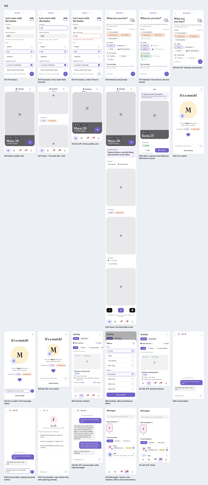

## Before and after (V2 on the left, V3 on the right)

| | |
|---|---|
| 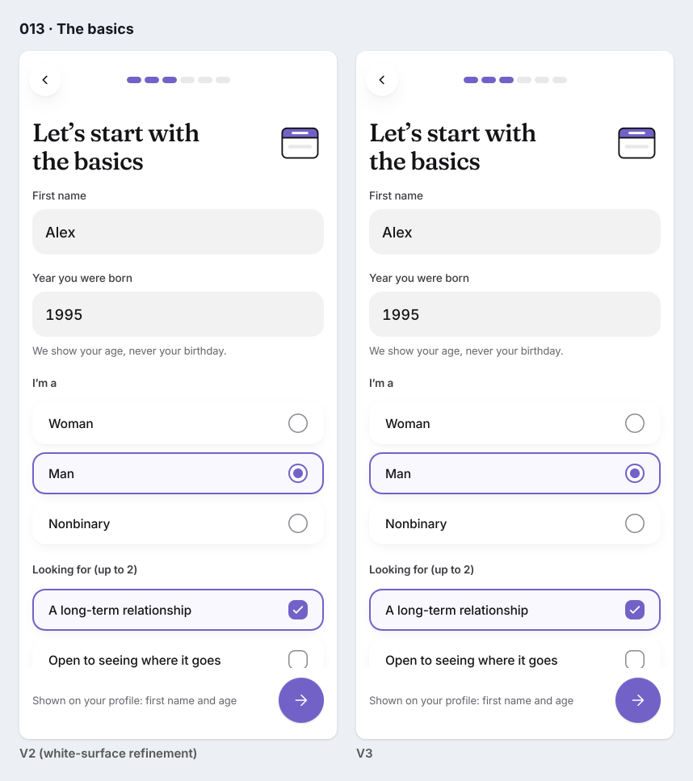 | 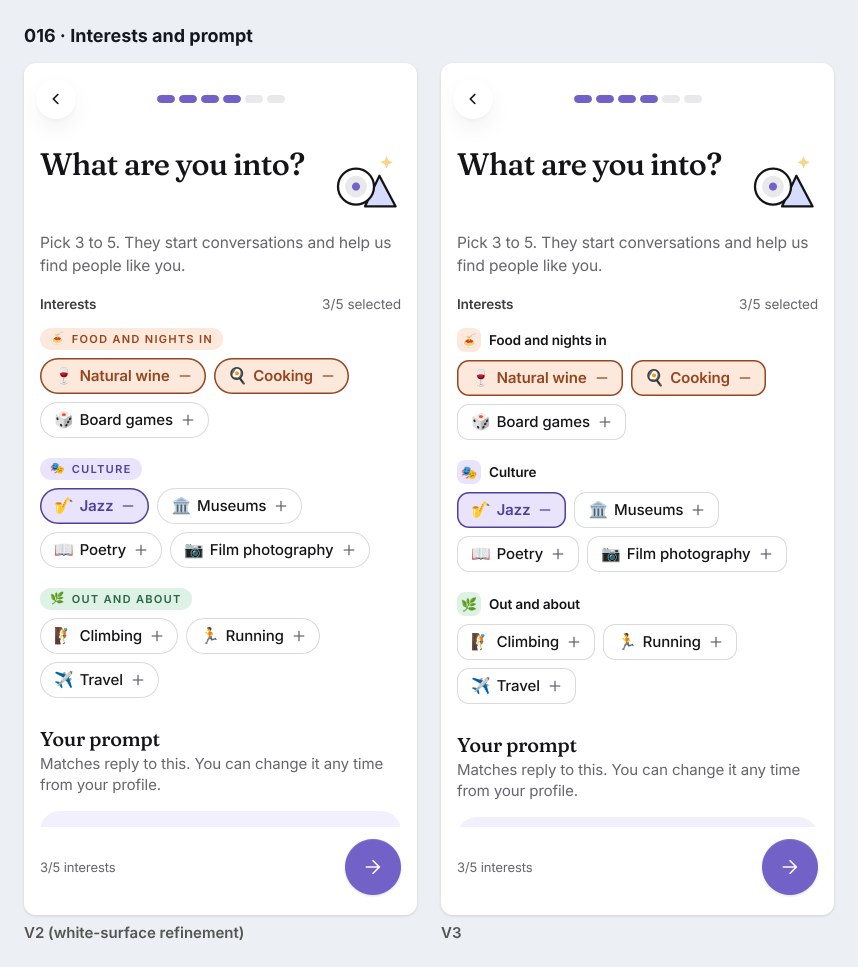 |
| 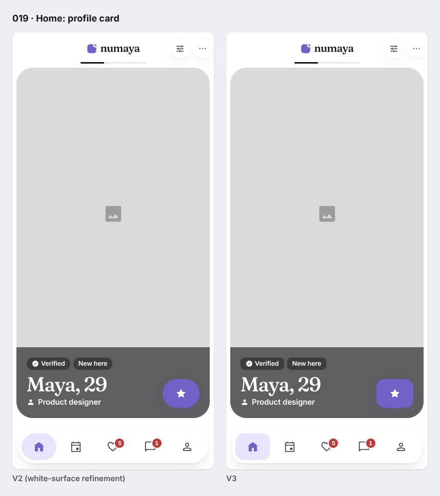 | 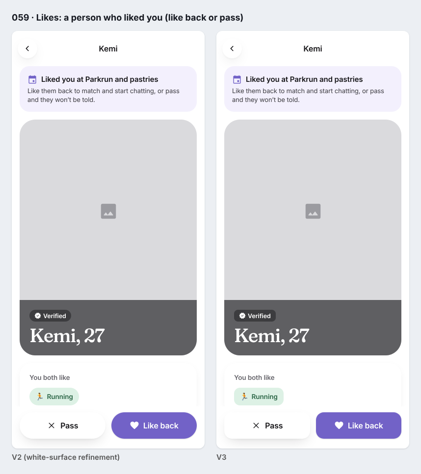 |
| 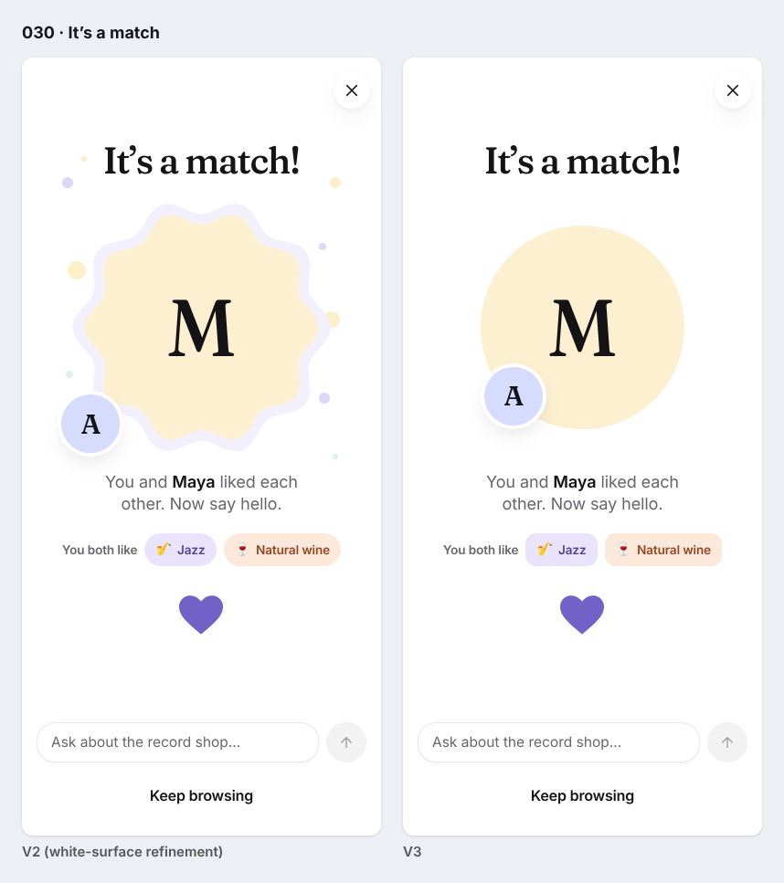 | 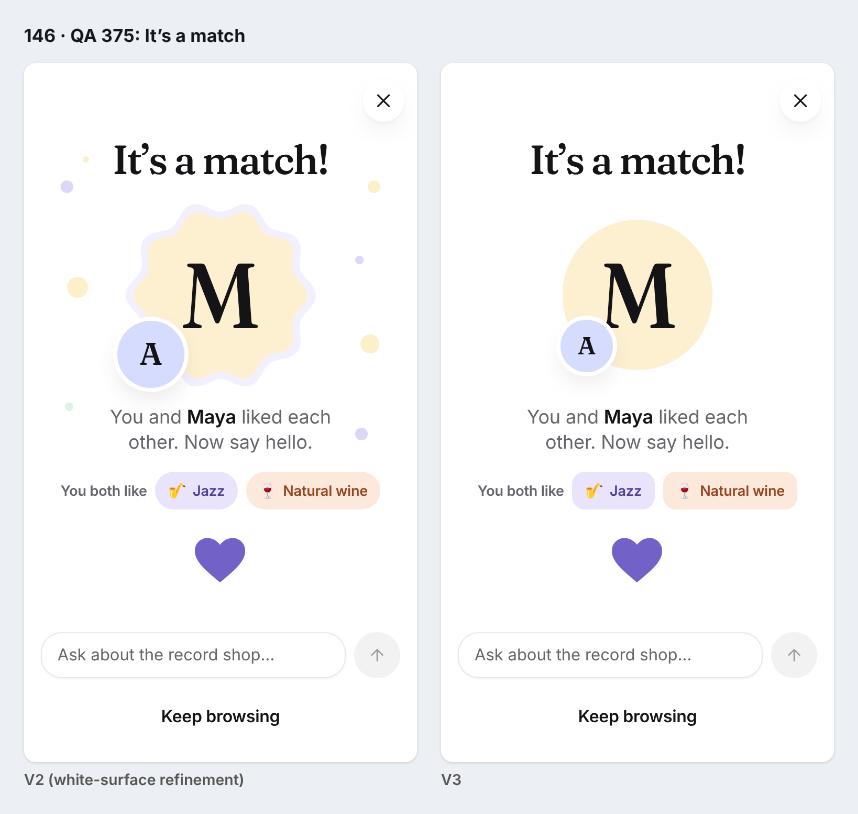 |
| 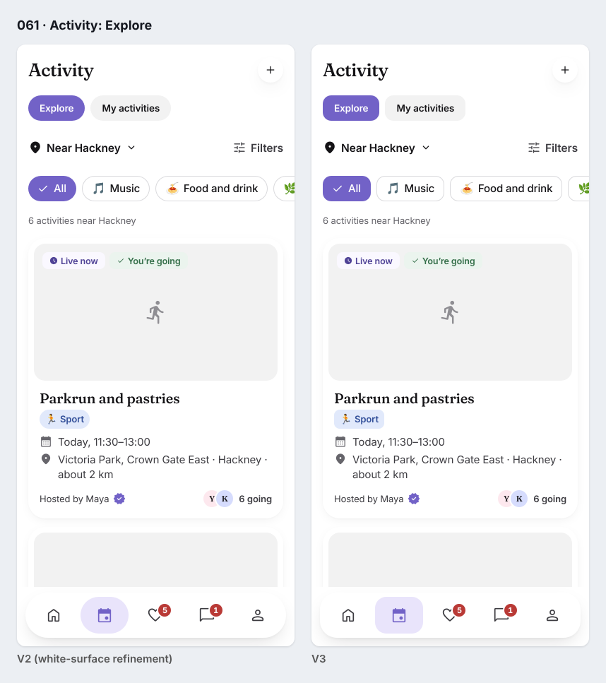 | 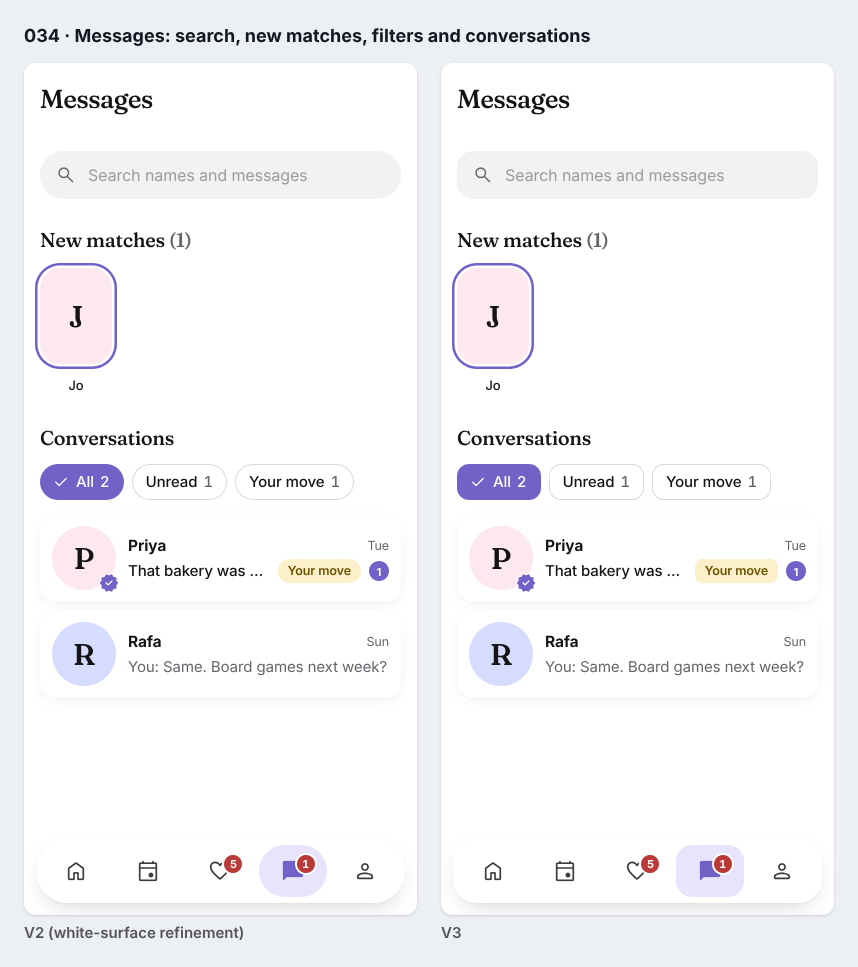 |
| 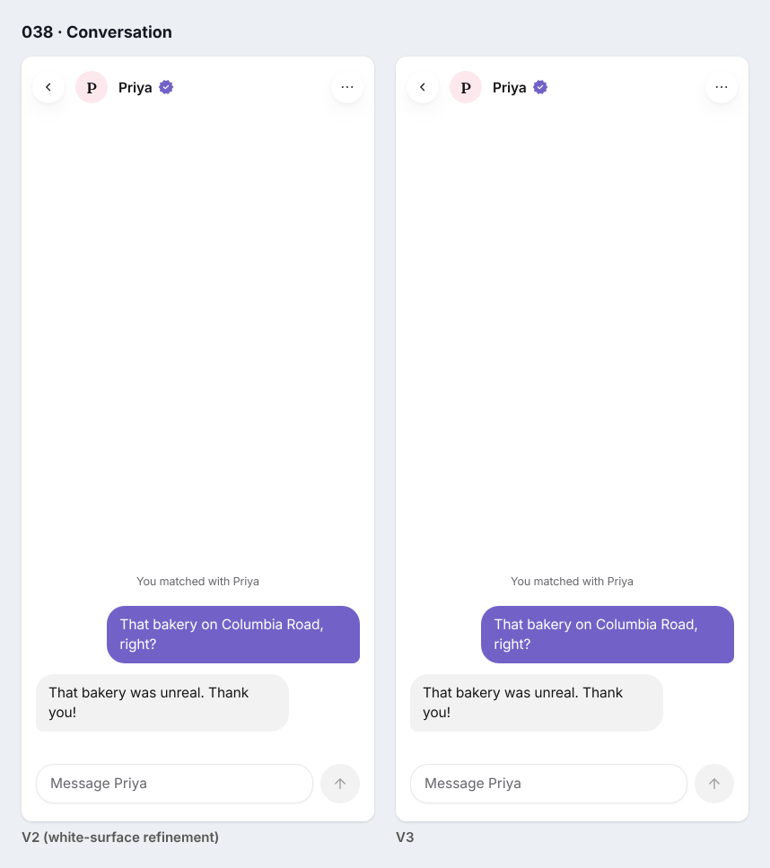 | 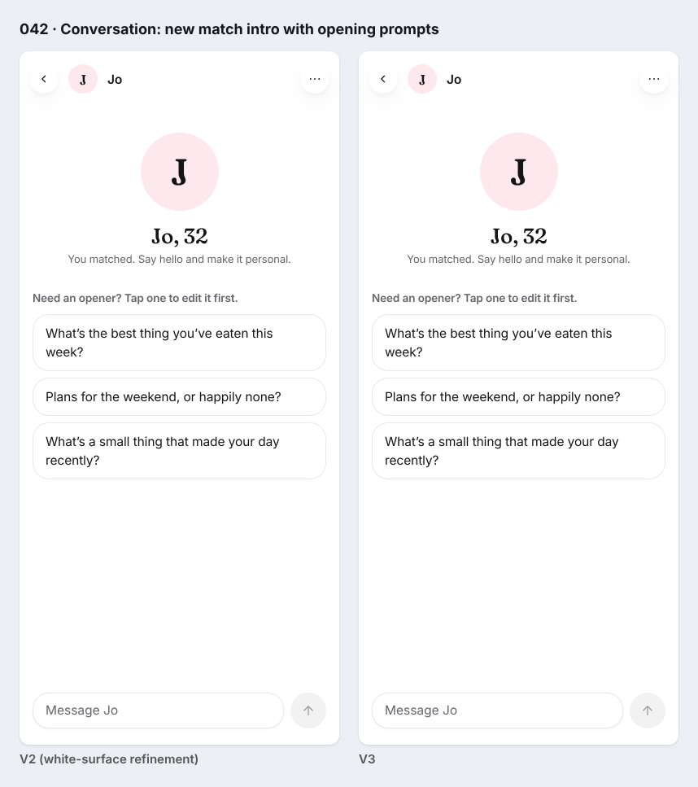 |

All 23 pairs are in [screenshots/comparisons](screenshots/comparisons/). They include the full
profile scroll (020), the error and focus states, and the 375 × 667 versions of Interests,
Discover, Match, Messages, Conversation and Activity.

### The photo fade, on a test image

The sample profiles have no photos, only grey placeholders, so the fade never shows in the gallery.
To review it, a test image drawn on a canvas was put into the photo slot. **It is a test pattern,
not a photograph.**

| | |
|---|---|
| 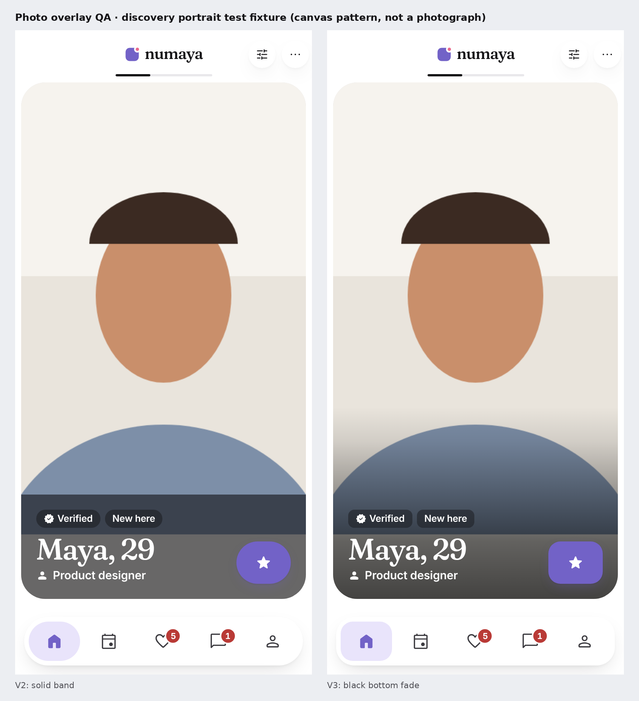 | 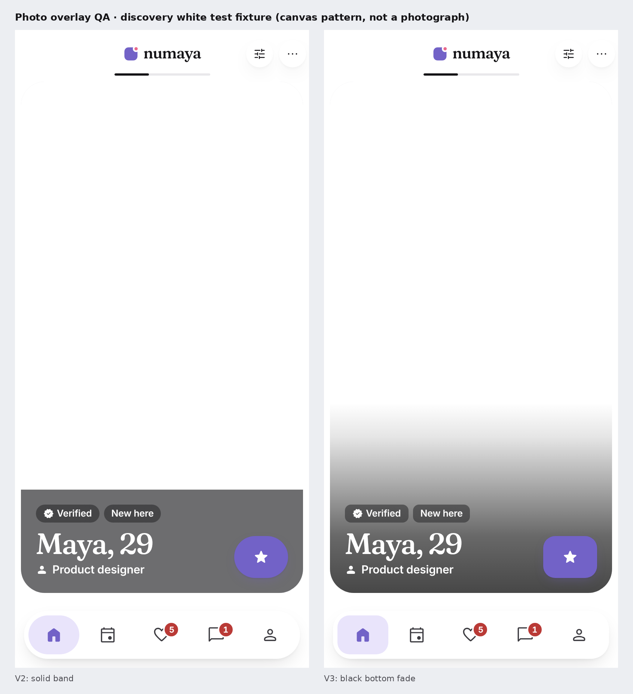 |

## The photo-overlay rule

- **Where:** only on `.profile-card__overlay`, the layer that holds the name, age, badges and
  SuperSwipe on a profile photo (Discover and Like back), and only when the photo container holds a
  real ``.
- **What:** `linear-gradient(to top, …)` in pure black, from 72% opacity at the bottom to
  transparent. Its stops ease out: 59% at 30%, 32% at 58%, 10% at 82%, 0 at the top. It is clipped
  by the photo's own 32px corners. The upper 47% (Like back) to 63% (Discover) of the photo has no
  overlay, which keeps faces clear.
- **Never:** on placeholders, surfaces, cards, buttons, chips, bubbles or navigation. On a
  placeholder, the name sits on V2's solid translucent band instead.
- **Checked:** at runtime there is no gradient on any element or pseudo-element of the 12 themed
  screens or the match. With a pure-white test image, the name scores 4.81:1 and the detail line
  6.90:1.

## Geometry

| Shape | Radius | Used for |
|---|---|---|
| Card | 24 (feature) / 16 (item) | Unchanged from V2 |
| Button | 16 | Primary and secondary buttons; the 72 × 56 Pass, SuperSwipe and Like buttons; search |
| Control | 12 (new `tiimo.radius-control`) | Interest and filter chips, shared-interest chips, small buttons, segmented options |
| Tag | 8 (new `tiimo.radius-tag`) | Photo badges ("Verified", "New here"), "Your move", "New", activity category tags, the category emoji holder |
| Tab bar | 24, with 16px items | The floating tab bar |
| Circle | 50% | Avatars, icon buttons (back, close, filters), the FAB, send, the match portraits |
| Pill | kept | Progress bars, switches, slider tracks, count badges: shapes that carry meaning |

## Match

- **Before:** an organic scalloped frame on a lavender halo, confetti dots, and your avatar at the
  lower-left corner of the frame's box.
- **After:**
  - Their photo is a clean circle and stays the dominant image (223px at 393 × 852). It is a 43%
    circular clip on the existing component, so no component code changed.
  - Your avatar (64px) sits with its centre on the circle's lower-left edge, just inside it.
  - On short phones your avatar scales with their portrait (50px at 375 × 667), so it never covers
    the centre.
  - The white ring on your avatar stays: it separates the two faces where they overlap.

## Headings

- **Interest sets:**
  - Before: peach, lilac and mint capsules with coloured uppercase text.
  - After: a neutral ink heading in sentence case. The category colour moved into a small tinted
    holder behind the emoji.
- **"A perfect first date" (the prompt question):**
  - Before: purple text.
  - After: neutral secondary text, like every other section title. The lavender tile and quote mark
    still say "prompt".
- **Kept:** colour that means something:
  - selected interests (category tint and ink);
  - shared interests (category);
  - activity category tags;
  - states ("Live now", "You're going", "Full", "Your move");
  - purple for actions and selection.

## Results

| Check | Result |
|---|---|
| Unit tests / build / tokens | 117/117 · pass · 306 tokens fresh |
| e2e smoke / product / experiment | 144/144 · 88/88 · **40/40** |
| axe, 10 views including themed Welcome and flows | 0 serious or critical |
| Default mode without the flag, 23 captures | byte-identical to V2; 22 are also byte-identical to the approved gallery (014 has no capture there) |

## Known limitations

- **No real photography in the repo.** The fade was judged on test patterns. The contrast numbers
  are computed for the worst case (pure white) and do not depend on the photo, but how the fade
  feels on real portraits still needs a look with real photos.
- **Pemu reference not available.** It was not found in Mobbin. The geometry is an original
  rounded-rectangle system, guided by the Tiimo analysis and similar Mobbin screens (Insight Timer,
  Bevel, Once).
- **The match crop is a clip.** The circle is a clip on the shared organic frame. Its visible circle
  is 87% of the frame box, so the portrait is about 13% smaller than V2's frame at the same width.
- **The placeholder band is still a hard block.** It applies only until a person adds a photo.
- **Only Chromium was tested**, and emoji glyphs differ by platform.
