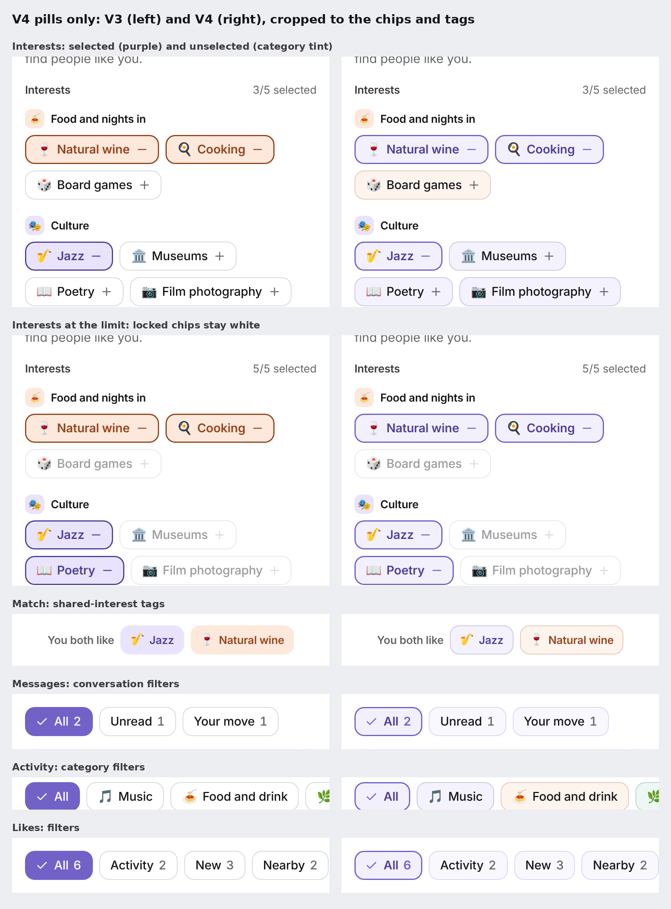

# Numaya × Tiimo V4: pill styling and targeted fixes

V4 is a narrow follow-up to [V3](../tiimo-inspired-v3/README.md), not a redesign. Three things
changed. Everything else is V3.

1. **Pills.** Chips and tags are softly rounded rectangles on a light tint with a fine outline.
   Selected chips have a purple outline on a light purple tint.
2. **Discover photo fade.** When a real photo is present, a black fade sits over its lower part.
3. **Match.** The scalloped silhouette is back, behind a rounded-square photo. There is still no
   halo and no confetti.

- **Branch:** `experiment/tiimo-inspired-v4`, from `experiment/tiimo-inspired-v3` at `6e4a818`
  (fetched and verified).
- **Preview:** `npm run dev`, then open:
  - `/flows.html?screen=interests&theme=tiimo`
  - `…?screen=discovery&theme=tiimo`
  - `…?screen=match&theme=tiimo`

  The match screen shows the match after you like Maya back on Discover; otherwise it shows its
  empty state. Other screens: `likes`, `like-profile`, `chats`, `chat`, `activity`. Without
  `&theme=tiimo` the approved design shows, unchanged.
- **Reference screenshots:** none were attached to the brief, so the pill treatment follows its
  written description: subtle tint, fine outline, about 12–16px corners.

## Pills only, V3 and V4

## Exact changes

All changes are in `src/design-system/styles/theme-tiimo.css`, scoped to `.theme-tiimo`, plus six
new tokens.

| Area | Change |
|---|---|
| Pill tokens (new, dedicated) | `tiimo.radius-pill` 12px; `color.tiimo.pill-fill` (purple 50), `pill-outline` (purple 200), `pill-selected-fill` (purple 100), `pill-selected-outline` (purple 600), `pill-selected-ink` (purple 800). Only `.chip` uses them. |
| Unselected chip | 12px corner on a 36px chip, `pill-fill` with a 1px `pill-outline`. A chip with a category (interests, Activity filters, shared interests) uses its pastel at half strength, with a 1px outline in its own ink at 24% opacity. |
| Selected chip (interests and filters) | `pill-selected-fill` with a 1.5px `pill-selected-outline`, `pill-selected-ink` text (7.3:1) and the existing purple minus or check glyph. This replaces V3's category-tinted selection and the approved solid-purple filter chip. |
| Locked chip (at the limit) | White with a pale outline, so it reads as unavailable. |
| Shared-interest tags | The same pill shape. The text keeps the category ink. |
| Discover actions | V3's 16px override on Pass, SuperSwipe, Like and the star on the photo is **removed**. They are back to the approved 72 × 56 pill (radius 28). |
| Discover fade | A `::before` layer on the photo container, only with a real ``. It is black, rises from the bottom over 60% of the photo's height (72% → 58% → 30% → 7% → 0 opacity), sits above the photo and below the text and SuperSwipe (z-index 1 and 2), and is clipped by the photo's corners. Placeholders keep V3's solid band. |
| Match | The shared component's scallop is now a solid butter silhouette. The person's image (or placeholder) is a rounded square at 64% of the frame with 24px corners, inside it. Your 64px circular avatar is centred near the image's lower-left corner (50px on short phones). The lavender halo stays hidden, and there is no confetti. |

## Intentionally unchanged (still V3)

- Primary and secondary buttons, including Continue, Pass and Like back (16px), and small buttons.
- Discover action buttons and the star on the photo (restored to the approved pill).
- Avatars, icon buttons, the FAB, the send button and navigation icons (circles).
- The bottom tab bar and its active pill (24px and 16px).
- Segmented tabs (Explore / My activities), search fields, text inputs and message composers.
- Cards, sheets, profile-photo containers, bubbles, photo badges and status tags.
- Switches, sliders and progress bars.
- Typography, spacing, layout, copy, emoji and colours outside the pills.

## Screenshots

| | Path |
|---|---|
| V3 baseline (17 states) | `screenshots/baseline/screens/` |
| V4 final (17 states) | `screenshots/final/screens/` |
| Before/after pairs | `screenshots/comparisons/` |
| Pill-only sheet | `pill-comparison.png` |
| Contact sheet (V4) | `contact-sheet.png` |
| Discover photo fade on canvas test patterns (not photographs; the repo has none), V3 and V4 | `screenshots/photo-qa/` |

The states captured are:
- Interests: 016, 017, 144 (375 × 667)
- Discover: 019, 021, 145 (375 × 667)
- Match: 030, 032, 146 (375 × 667)
- Likes: 054, 059
- Messages: 034, 147 (375 × 667)
- Conversation: 038, 042, 148 (375 × 667)
- Activity: 061

All are at 393 × 852 unless noted.

## Results

| Check | Result |
|---|---|
| Unit tests / build / tokens | 117/117 · pass · 312 tokens fresh |
| e2e smoke / product / experiment | 144/144 · 88/88 · **48/48** |
| axe, 10 views including themed Welcome and flows | 0 serious or critical |
| Default mode without the flag | 16 states byte-identical to V3 without the flag; 054 byte-identical to the approved gallery |

The experiment e2e covers the following:

| Check | Result |
|---|---|
| Chip corners | 12–16px, measured 12px on 36px chips |
| Unselected chips | light tint with a 1px outline |
| Chip text contrast | ≥ 4.5:1 (worst 7.32:1) |
| Selected chip | purple outline on the light purple tint |
| Pass, SuperSwipe, Like and the star | still 28px |
| Icon buttons | circular |
| Tab bar | 24px |
| Shared tags | 12px |
| No gradient | anywhere when the profiles are placeholders |
| With a white test image | black fade, above the photo and below the text and actions, upper 40% clear; name 5.74:1 and detail 7.23:1 over pure white on Discover (4.48 and 6.58 on Like back) |
| Match | scallop silhouette present, image a rounded square (166px at 24px), avatar centre 7px from its lower-left corner, no halo or confetti |

## Known limitations

- **No reference image and no real photos.** The pills follow the written brief, and the fade was
  checked on canvas test patterns.
- **On a light photo, the fade starts to darken the lower part of the frame.** With the test
  pattern it reaches the chin (about 50% down). On real portraits faces usually sit higher, but
  this is worth checking with real photos.
- **Selected chips no longer show their category colour.** The brief asks for a purple selection.
  The category stays visible in the heading's emoji holder and on the unselected chips.
- Only Chromium was tested.
