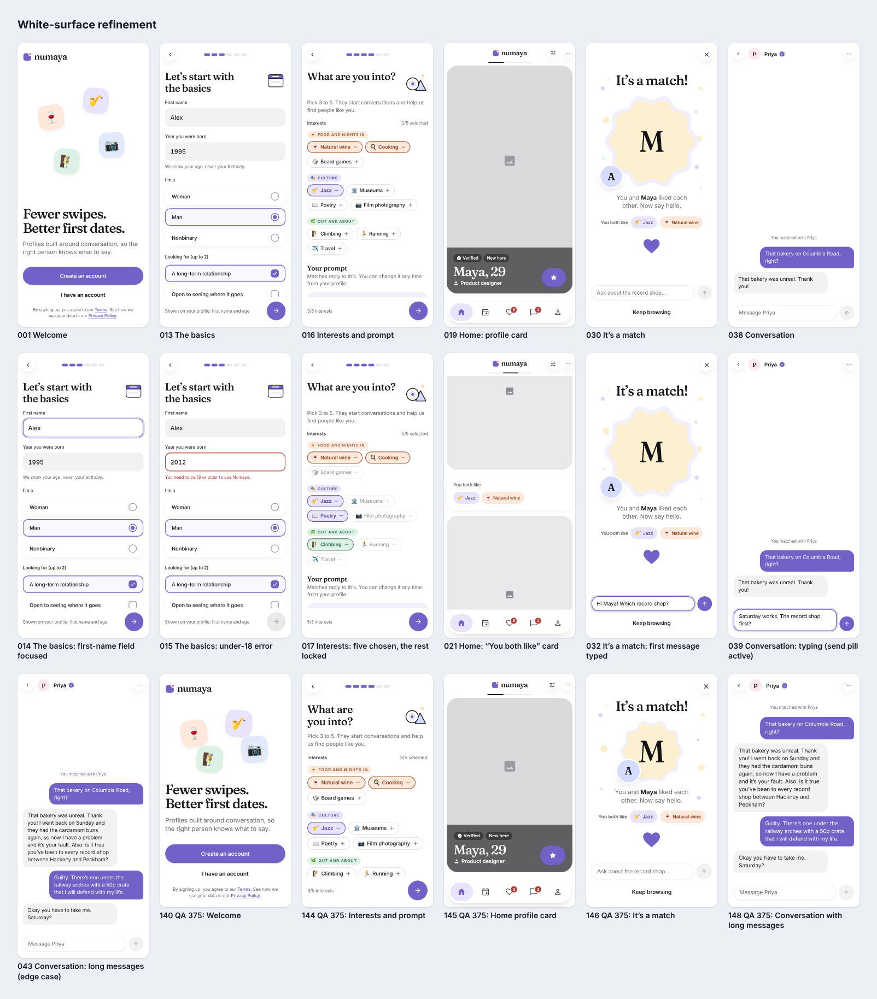
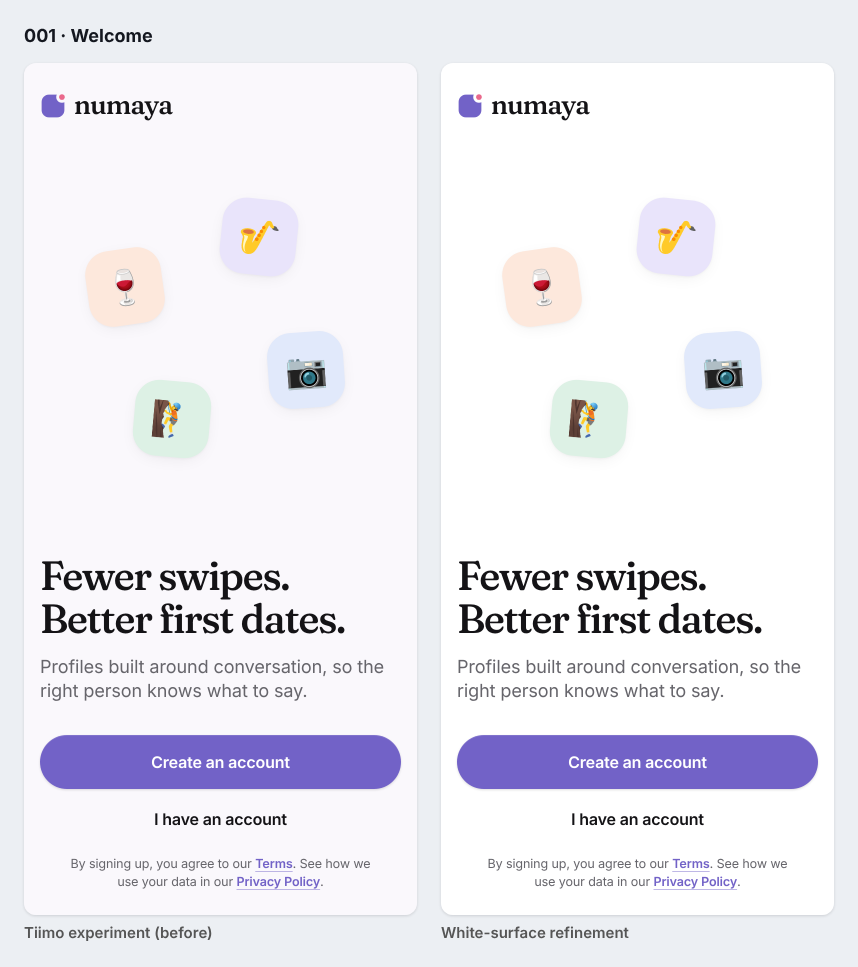
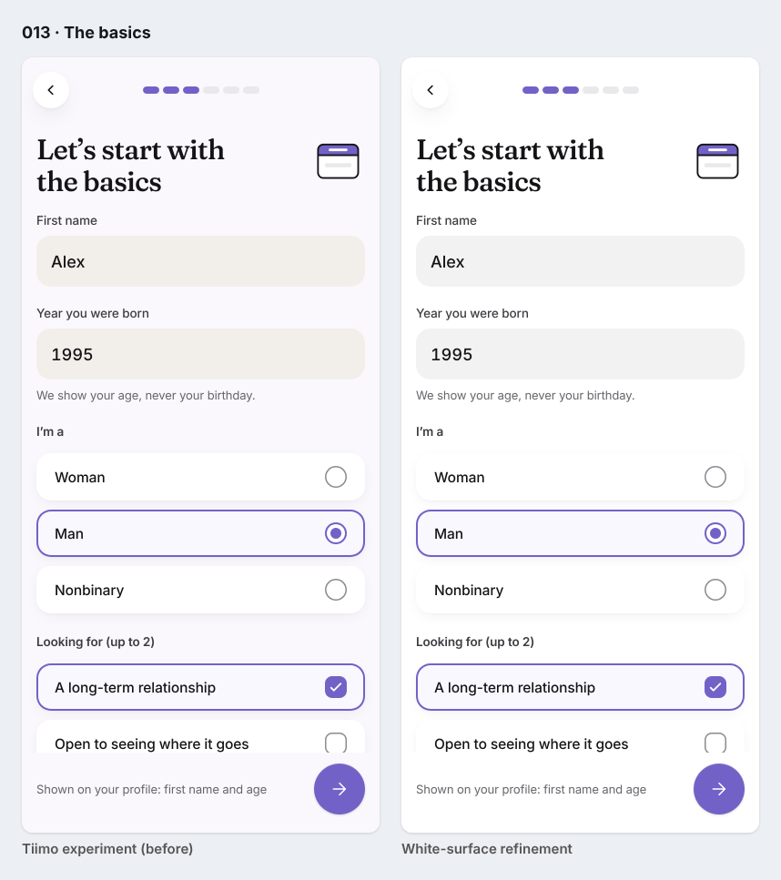
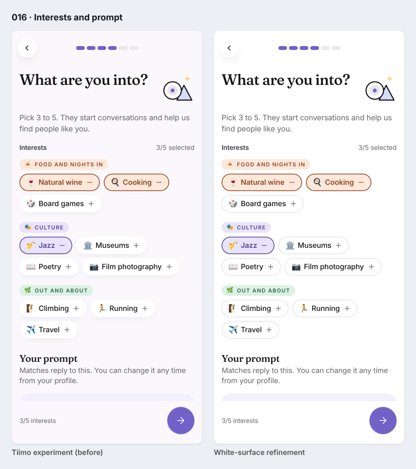
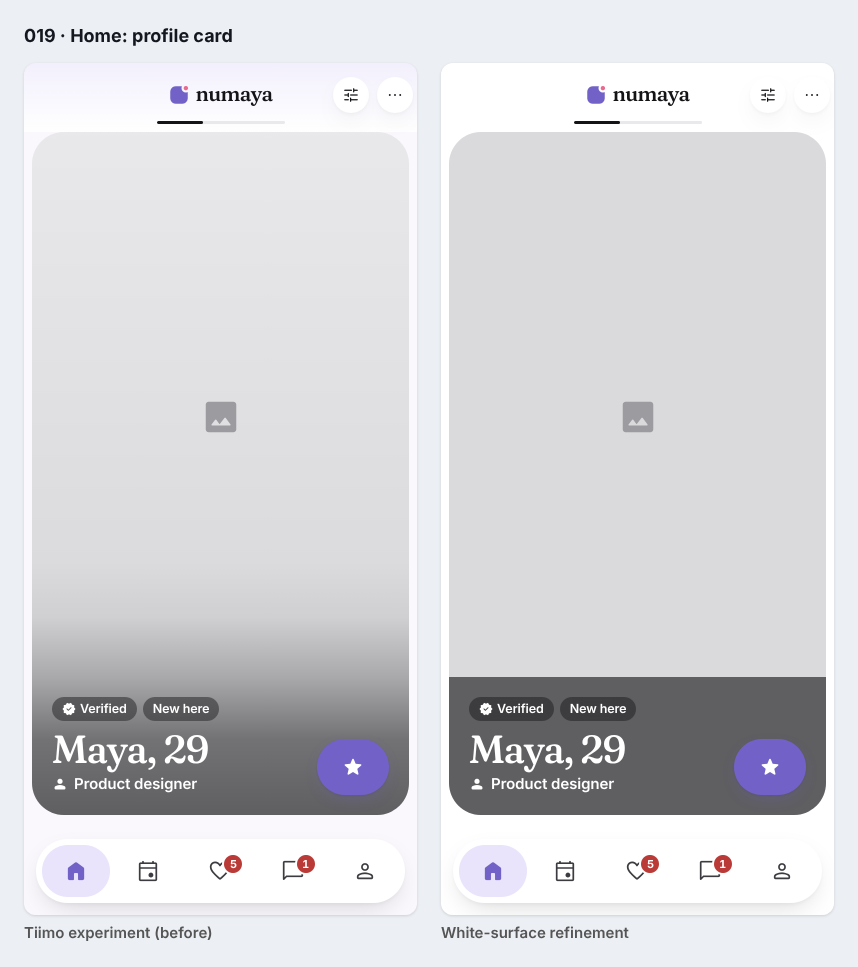
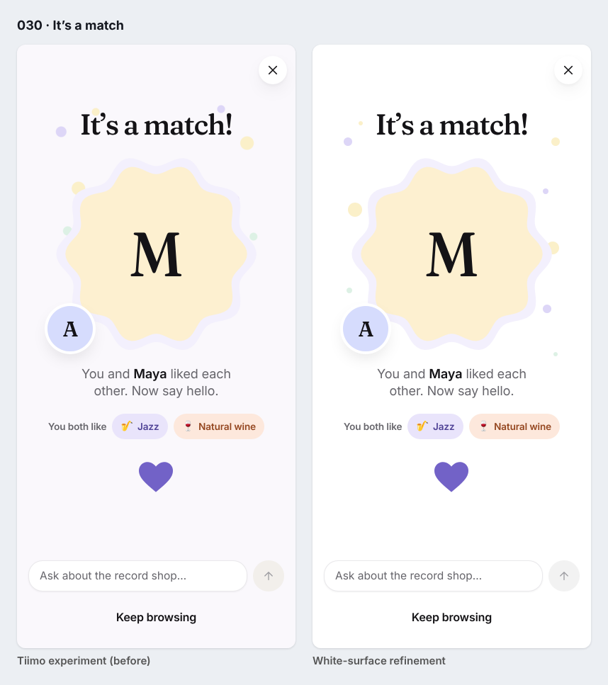
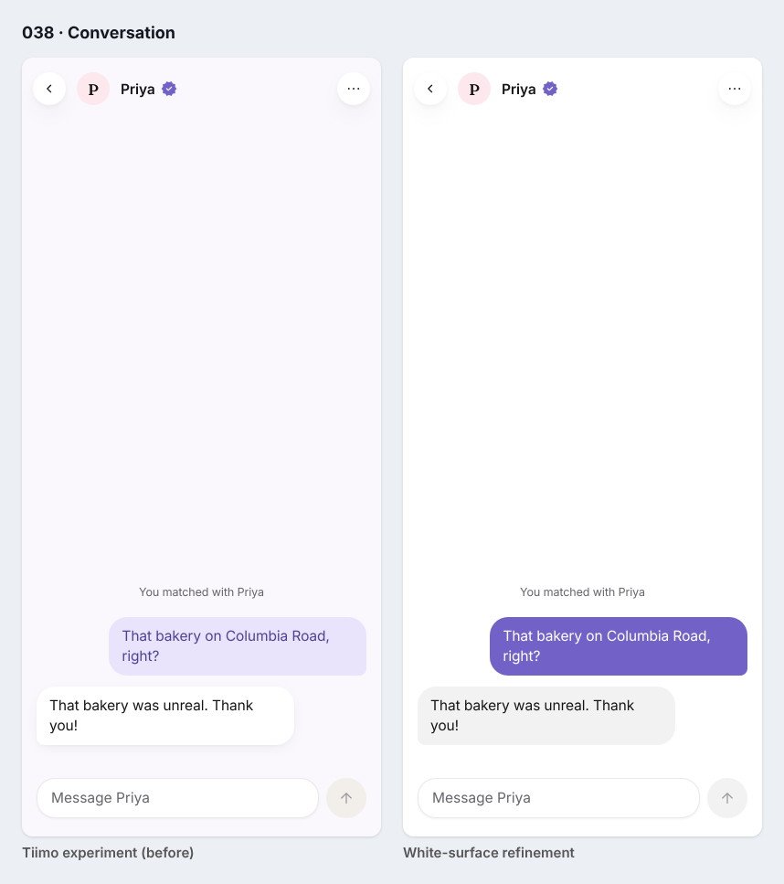

# Numaya × Tiimo, refinement V2: white surfaces, no gradients

A targeted refinement of the opt-in Tiimo-inspired experiment
([original report](../tiimo-inspired-experiment/README.md)). It is not a redesign: the palette,
purple actions, category tones, emoji, chips, geometry, dashed photo slots, layouts and typography
are unchanged. Three things changed:

1. **No gradients.** Every gradient the themed screens drew is now a solid colour, checked on the
   computed styles at runtime, not just in the source.
2. **Pure white backgrounds.** The canvas is `#FFFFFF`. White cards separate by spacing and the
   existing restrained card shadow; nothing compensates with outlines, heavier shadows or blobs.
3. **Your messages are solid brand purple with white text.** Theirs are the light neutral grey.

Also: the warm "stone" field fill is gone. Fields use the existing light neutral, `neutral.100`
(`#F2F2F2`), the approved `surface-soft`.

- **Branch:** `experiment/tiimo-white-surface-refinement`, from `experiment/tiimo-inspired-12-screen`
  (`36686f8`). Neither the original Tiimo branch nor the approved `design/apple-impeccable-full-app`
  was modified.
- **Try it:** `npm run dev`, then add `?theme=tiimo`, for example
  `/flows.html?screen=chat&theme=tiimo` or `/?theme=tiimo`. Without the flag you get the approved
  design, byte-identical in all 18 captured states.
- **Details:** [validation-report.md](validation-report.md)

## The six screens after the refinement

## Before and after

The left side of each image is the Tiimo experiment as committed (`36686f8`); the right side is
this refinement. Same state and viewport.

| | |
|---|---|
|  |  |
|  |  |
|  |  |

More states, including the 375 × 667 versions of the densest screens, are in
[screenshots/comparisons](screenshots/comparisons/): 014 (field focused), 015 (under-18 error),
017 (interests at the limit), 021 ("You both like"), 032 (match with a message typed), 039 (typing),
043 (long messages), and 140, 144, 145, 146 and 148 at 375 × 667.

## What changed, screen by screen

| Screen | Before (Tiimo experiment) | After |
|---|---|---|
| Welcome | Lilac-white canvas over the approved wash gradient; primary button with a top-to-bottom gradient | White page; solid purple primary button; stickers unchanged |
| Basics | Lilac canvas, warm stone fields, gradient FAB | White page; neutral grey `#F2F2F2` fields; solid purple FAB; option cards white with the same light shadow, selected keeps the purple ring |
| Interests | Lilac canvas; chips with a small lift shadow | White page; chips back on the approved hairline (no shadow); capsules, emoji and tinted selection unchanged |
| Discover | Lilac header wash gradient; photo placeholder "lit from above"; long dark ramp behind the name; sheen on Pass/Like | White header; one solid photo grey; a solid translucent ink band behind the name; solid Pass/Like; SuperSwipe stays solid purple |
| Match | Lilac canvas; confetti drawn with radial gradients; gradient primary | White page; confetti as solid dots (box-shadow copies), still in the margins; solid primary |
| Conversation | Lilac tile with deep-purple text for your messages; white lifted bubble for theirs | Solid brand purple `#7262C7` with white text (4.90:1) for yours; light grey `#F2F2F2` with ink text (16.53:1) for theirs |

## Gradients removed

All overrides are scoped to `.theme-tiimo`; the approved CSS files are untouched.

| Source (approved CSS) | Element | Replacement in the theme |
|---|---|---|
| `components.css` | `.btn--primary` and hover, `.fab` | Solid `--button-primary-bg-top` (hover: `-hover-top`) |
| `components.css` | `.screen--wash` | Solid page colour (white) |
| `screens.css` | Welcome wash | Already overridden by the theme; now resolves to white |
| `flows.css` | `.fl-disc-head` (Home header) | Solid page colour (white) |
| `content.css` | Profile-card photo placeholder | Solid `--color-surface-photo` |
| `content.css` | `.profile-card__overlay` scrim | Solid `--color-overlay-photo` band (ink at 62%) |
| `content.css` | `.action-bar__btn` (Pass, Like) | Solid `--button-ink-bg-bottom` |
| `content.css` | `.skeleton` shimmer | Solid `--color-surface-sunken`, no animation |
| `selection.css` | Slider rail (hard-stop gradient) | Solid rail on `::before`, solid selected interval on `::after` |
| `theme-tiimo.css` | Match confetti (radial gradients) | Solid dots: one pseudo-element each side, copies via zero-blur box-shadow |

Out of scope: `device.css` draws a gradient on the desktop simulator's device bezel. That is
presentation chrome around the phone in the desktop preview, not app UI, and it sits outside the
themed screen, so it was left alone.

## Tokens

- `color.tiimo.canvas` now points at `neutral.0` (`#FFFFFF`).
- Removed: `color.tiimo.field` and the two primitives only it and the canvas used (`lilac.25`,
  `stone.100`). The theme no longer reassigns `--color-surface-soft`, so fields, quiet controls and
  incoming bubbles use the approved neutral grey.
- Unchanged: the five category tints and inks, `shadow.tiimo-card`, `shadow.tiimo-float` and the
  `tiimo` geometry. 302 tokens in total (305 before).

## Results

| Check | Result |
|---|---|
| Runtime gradient scan: every element and `::before`/`::after` inside the theme, on all 12 themed screens | **0 gradients** (the same scan fails on 7 of the 12 screens of the original experiment) |
| Default mode without the flag, 18 captures | **Byte-identical** to the approved design |
| Unit tests / build / tokens | 117/117 · pass · 302 tokens fresh |
| e2e smoke / product / experiment | 144/144 · 88/88 · **25/25** |
| axe (10 views, incl. themed Welcome and flows) | 0 serious or critical |

## Trade-offs and remaining issues

- **The name band on Discover is heavier.** A solid translucent band replaces the long soft ramp.
  It keeps white text above 4.5:1 over any photo, but on the grey placeholder it reads as a hard
  block. With real photography it should look closer to a caption bar; that is untested here because
  the prototype has no photos.
- **Option cards keep a light shadow.** The brief prefers compact controls without shadows. Fields,
  the composer and chips are flat; the radio and checkbox rows are larger, card-like items, and
  without either a shadow or a hairline they would vanish on white. I kept the existing restrained
  card shadow rather than bring back a border.
- **Match confetti is quieter on white** than on the lilac canvas. It stays static and solid.
- **Only Chromium was tested**, and emoji glyphs differ by platform.
