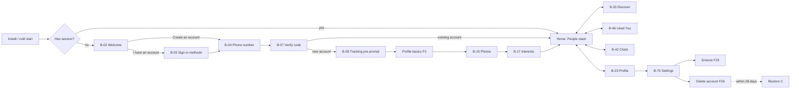
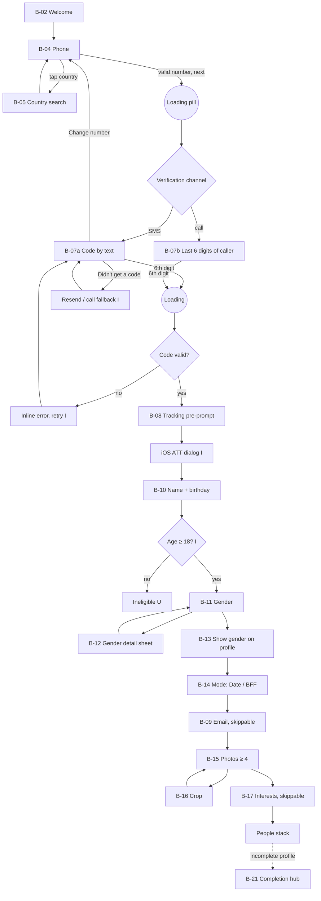
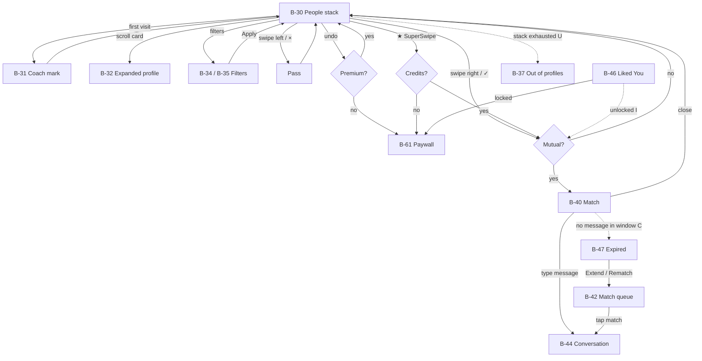
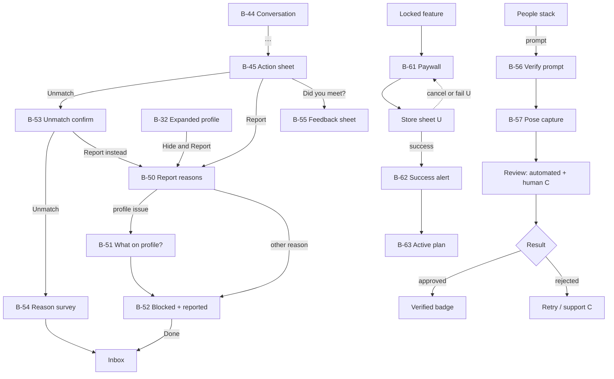
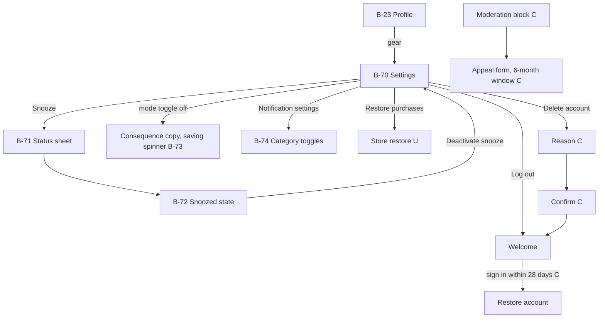

# End-to-end journey map

This is the reference journey of Bumble Dating (iOS), reconstructed from Mobbin captures and
official help pages. Node labels use the screen IDs from [flow-catalogue.md](flow-catalogue.md).
Dashed edges are inferred [I] or come from official documentation [C], not from captures.

## 1. Lifecycle overview

## 2. Account creation and onboarding (F1, F3–F5)

## 3. Discovery, matching and chat (F9–F17)

## 4. Safety, verification and premium (F17–F21)

## 5. Settings and account lifecycle (F22–F28)

